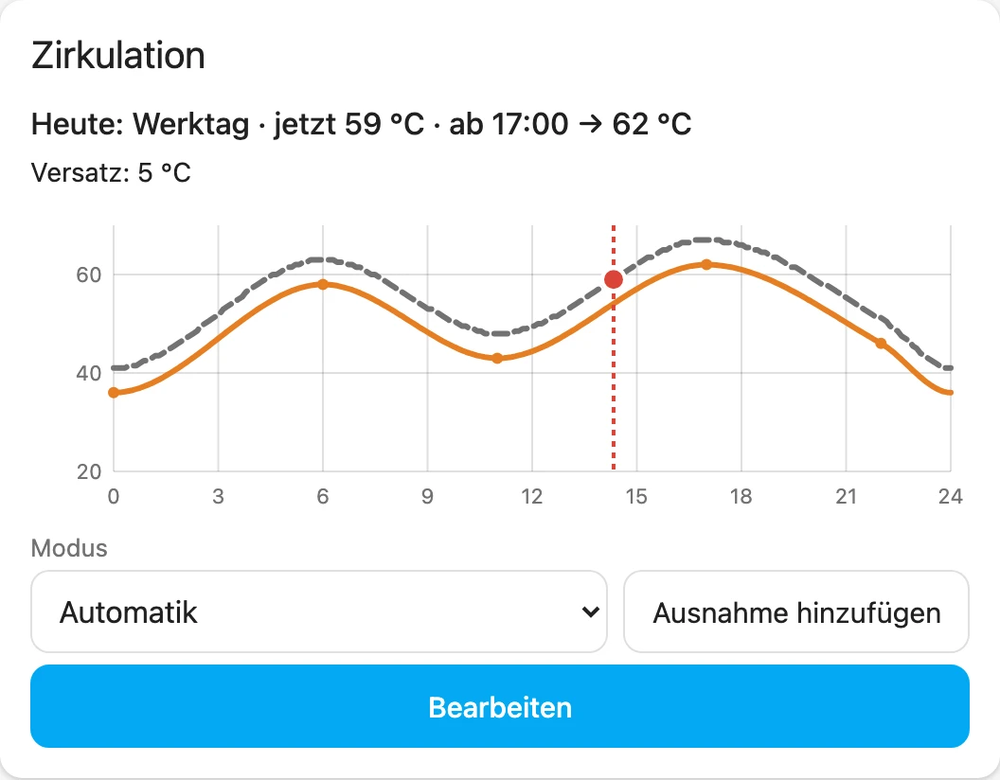
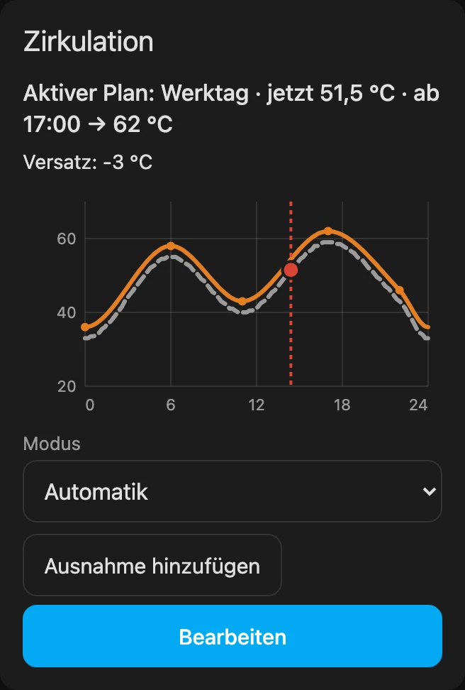
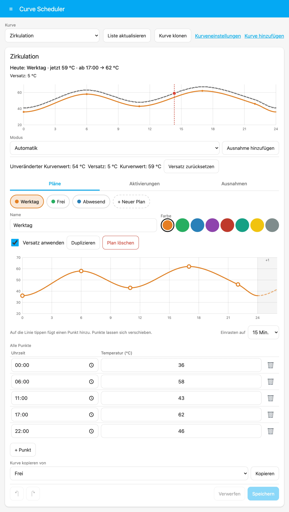
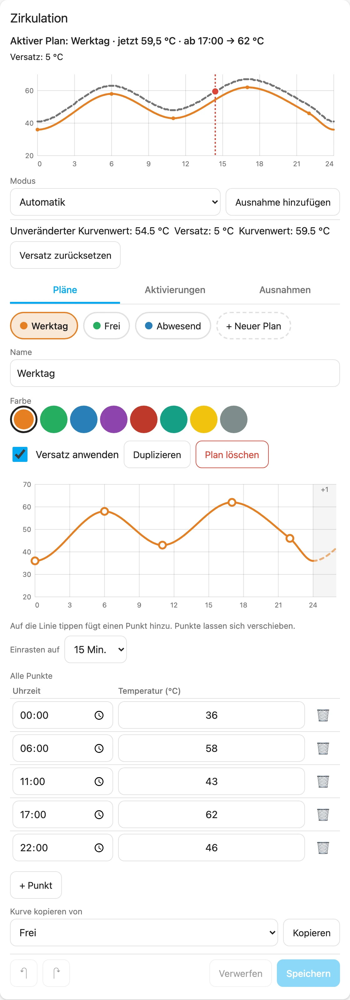
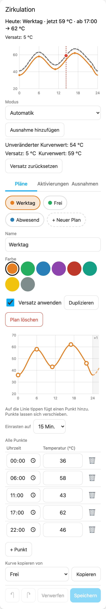
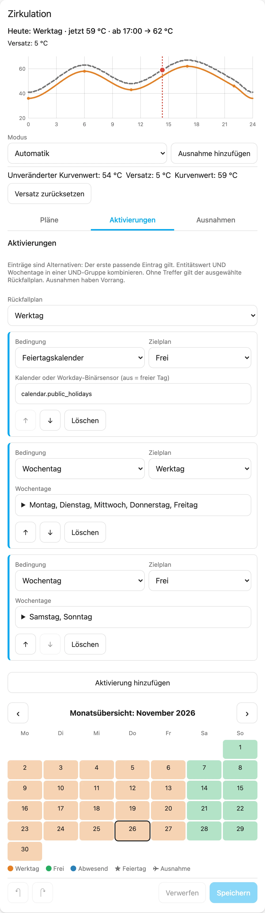
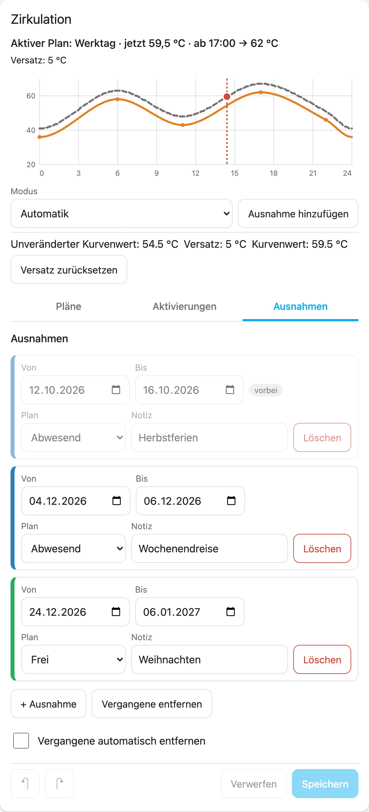
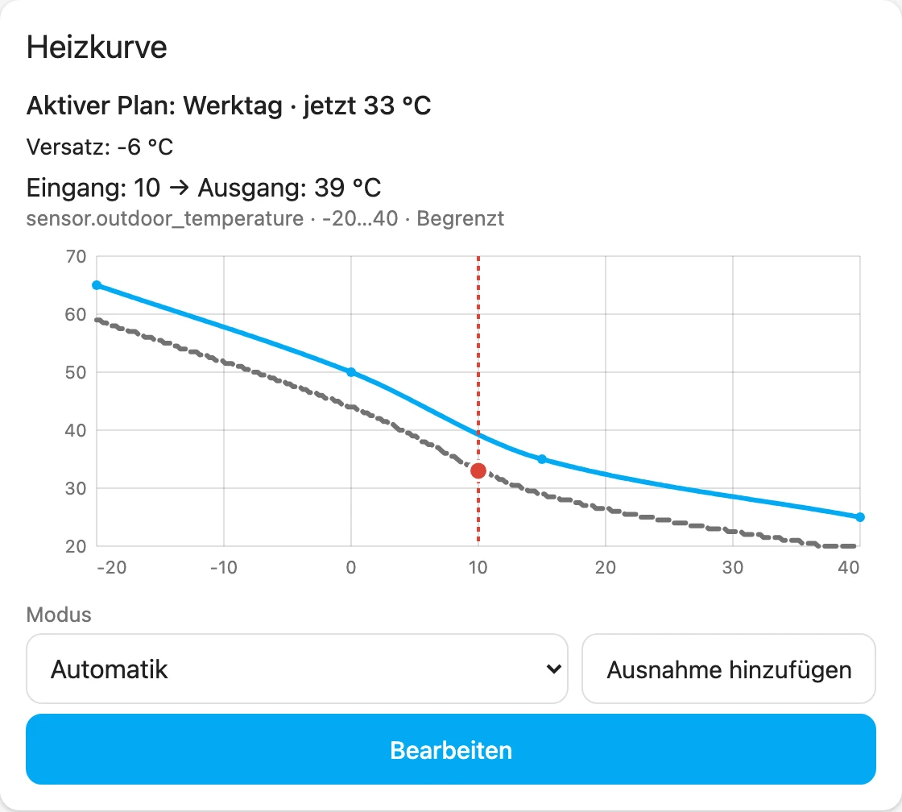
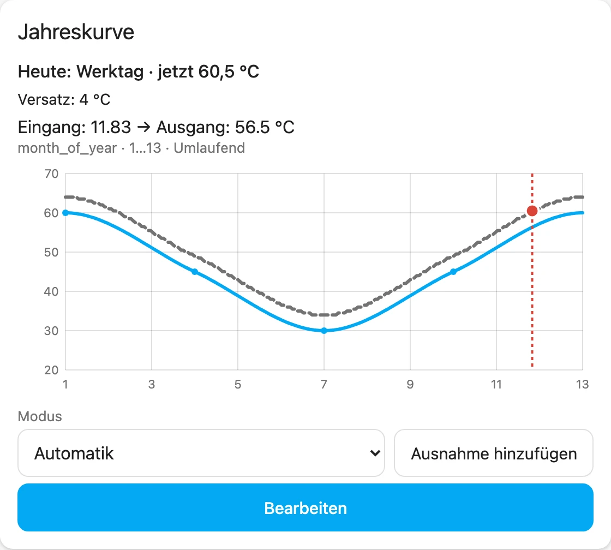
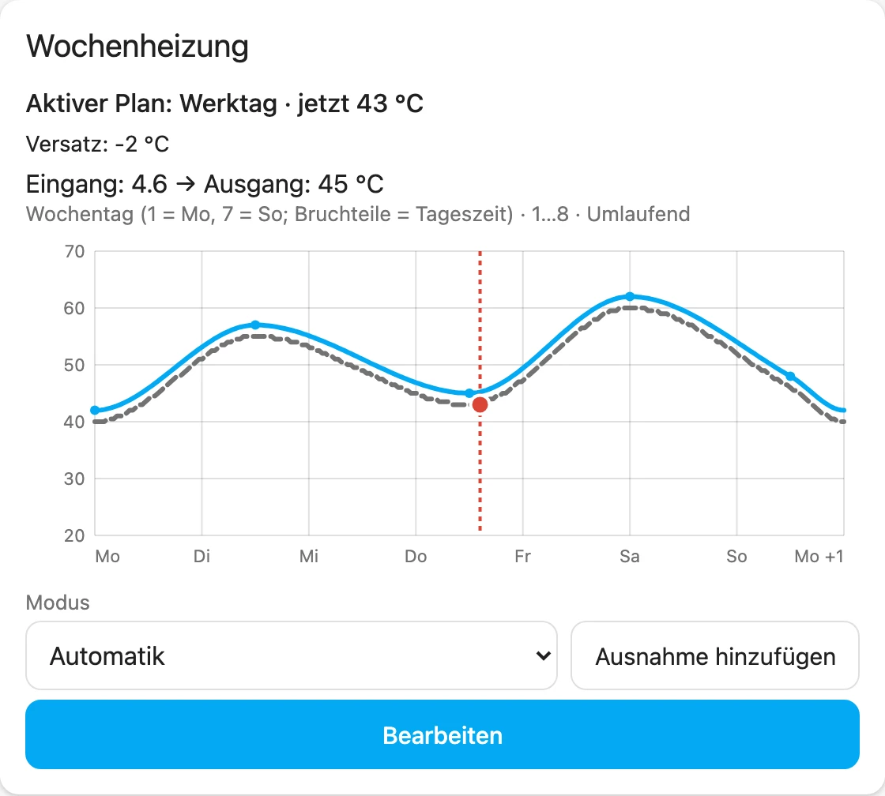

# Curve Scheduler

Home-Assistant-Integration für Sollwertkurven mit einem visuellen, für Touch-Bedienung geeigneten Editor

> **Fork und Danksagung:** Dies ist ein unabhängig gepflegter Fork von
> [timzifer/ha-curve-scheduler](https://github.com/timzifer/ha-curve-scheduler).
> Vielen Dank an Tim ([@timzifer](https://github.com/timzifer)) und die ursprünglichen
> Mitwirkenden für die Integration, den visuellen Editor und die Grundlage dieser
> Weiterentwicklung. Diesen Fork pflegt Jonas Poessl ([@poessl](https://github.com/poessl)).
> Die ursprüngliche MIT-Lizenz und der Urheberrechtsvermerk bleiben in [LICENSE](LICENSE) erhalten.

> **Hinweis zur KI-Entwicklung:** Bei der Entwicklung dieses Forks wurde in großem
> Umfang KI-Unterstützung durch **Codex mit GPT-6.1 sol** eingesetzt. Die
> Konfiguration und Kurven vor dem Einsatz zur Gerätesteuerung prüfen und testen;
> KI-Unterstützung ist keine Garantie für Fehlerfreiheit.

**Erfordert Home Assistant 2026.11.3 oder neuer.** Die Integrationsdomäne bleibt
`curve_scheduler`: Diesen Fork anstelle des Originals installieren, nicht parallel dazu.

[](https://github.com/poessl/ha-curve-scheduler/actions/workflows/validate.yml)
[](https://github.com/poessl/ha-curve-scheduler/actions/workflows/ci.yml)
[](https://my.home-assistant.io/redirect/hacs_repository/?owner=poessl&repository=ha-curve-scheduler&category=integration)

🇬🇧 [English version](README.md)

**Curve Scheduler** berechnet aus einer Kurve einen numerischen Sollwert. Als
Eingang dienen die **Tageszeit**, ein **Sensorwert** (etwa die Außentemperatur),
der **Wochentag** oder der **Jahresmonat**. Damit lassen sich Warmwasser-Zirkulation, Heizkurven,
saisonale Temperaturen und andere numerische Größen steuern. Die Integration
schreibt in eine optionale Ziel-Entity; ohne Ziel liefern ihre Sensoren die Werte
für eigene Automationen.

Einige **Punkte** definieren die Kurve; der gewählte Übergang bestimmt die Werte
dazwischen. Mehrere **Pläne**, etwa *Werktag*, *Frei* und *Abwesend*, stehen zur
Auswahl. Geordnete Bedingungen wählen den aktiven Plan, ergänzt durch
Datumsausnahmen und manuelle Übersteuerungen. Bearbeitet wird in der
**Seitenleiste** oder einer **Dashboard-Karte**, per Touch, Maus, Eingabefeld oder
Tastatur. Für die alltägliche Planbearbeitung sind keine Admin-Rechte erforderlich.

<p align="center">
  
  
</p>

## Inhaltsverzeichnis

- [Benutzerhandbuch](#benutzerhandbuch)
  - [Funktionen](#funktionen)
  - [Installation](#installation)
    - [HACS (empfohlen)](#hacs-empfohlen)
    - [Manuell](#manuell)
  - [Einrichtung (einmalig durch einen Administrator)](#einrichtung-einmalig-durch-einen-administrator)
    - [Editor in der Seitenleiste öffnen](#editor-in-der-seitenleiste-öffnen)
    - [Ganze Kurve klonen](#ganze-kurve-klonen)
    - [Karte hinzufügen (optional)](#karte-hinzufügen-optional)
  - [Bearbeiten in Seitenleiste und Karte](#bearbeiten-in-seitenleiste-und-karte)
    - [Aktiver Plan](#aktiver-plan)
    - [Pläne](#pläne)
    - [Aktivierungen](#aktivierungen)
    - [Ausnahmen](#ausnahmen)
    - [Speichern](#speichern)
  - [Manuelle Zieländerungen beibehalten](#manuelle-zieländerungen-beibehalten)
  - [So wird der Wert berechnet](#so-wird-der-wert-berechnet)
  - [Wann wird geschrieben?](#wann-wird-geschrieben)
  - [Entities](#entities)
  - [Wochen-, Sensor- und Jahreskurven verwenden](#wochen--sensor--und-jahreskurven-verwenden)
    - [Beispiel: Heizkurve nach Außentemperatur](#beispiel-heizkurve-nach-außentemperatur)
    - [Beispiel: eine durchgehende Wochenkurve](#beispiel-eine-durchgehende-wochenkurve)
    - [An Grenzen stoppen oder wiederholen](#an-grenzen-stoppen-oder-wiederholen)
    - [Diagramme lesbarer machen](#diagramme-lesbarer-machen)
  - [Aktionen (Dienste)](#aktionen-dienste)
- [Entwicklerhandbuch](#entwicklerhandbuch)
  - [Architektur und Kompatibilität](#architektur-und-kompatibilität)
  - [WebSocket-API](#websocket-api)
  - [Einrichtung und Prüfungen](#einrichtung-und-prüfungen)
  - [README-Screenshots erneuern](#readme-screenshots-erneuern)
- [Lizenz](#lizenz)

## Benutzerhandbuch

### Funktionen

- Gemeinsamer Kurven-Editor für Tageszeit, Wochentag, Jahresmonat und Sensorwerte: Punkte mit Maus oder Finger ziehen oder Werte genau eingeben
- Numerische Eingänge an den Bereichsgrenzen begrenzen oder periodisch wiederholen, auch bei Sensorwerten
- Vier Übergänge: Stufe, linear, weich und Kurve (monoton kubisch, ohne Überschwingen)
- Geordnete Aktivierungen nach Wochentag, Monat, Tageszeit, Feiertagskalender/Workday-Sensor oder Entitätszustand/-attribut (exakt oder numerisch), mit AND/OR/NOT-Gruppen und Datumsausnahmen
- Optionale Zielüberwachung übernimmt manuelle Änderungen als additiven Versatz; je Plan abschaltbar
- Manuelle Planauswahl über Karte oder Auswahl-Entity; optionales Ablaufdatum über eine Aktion
- Rückgängig/Wiederholen, *Speichern*/*Verwerfen* und Warnung bei ungespeicherten Änderungen
- Mehrere gleichzeitig geöffnete Karten erhalten Aktualisierungen; konkurrierende Speichervorgänge werden erkannt
- Ausgabe an `number`-, `input_number`-, `climate`- oder `water_heater`-Entities
- Seitenleisten-Editor sowie kompakte, vollständige und reine Diagrammkarten; Deutsch/Englisch, helles/dunkles Design und Layouts ab 320 px

### Installation

#### HACS (empfohlen)

[Diesen Fork in HACS öffnen](https://my.home-assistant.io/redirect/hacs_repository/?owner=poessl&repository=ha-curve-scheduler&category=integration) oder manuell hinzufügen:

1. **HACS** öffnen → Menü (⋮) → **Benutzerdefinierte Repositories**.
2. `https://github.com/poessl/ha-curve-scheduler` mit der Kategorie **Integration** hinzufügen.
3. Nach **Curve Scheduler** suchen, installieren und Home Assistant neu starten.

#### Manuell

`custom_components/curve_scheduler` in den Ordner `custom_components` der
Home-Assistant-Konfiguration kopieren und neu starten.

Die Dashboard-Karte gehört zur Integration und wird automatisch registriert.
Eine zusätzliche Dashboard-Ressource ist nicht erforderlich.

### Einrichtung (einmalig durch einen Administrator)

**Einstellungen → Geräte & Dienste → Integration hinzufügen → Curve Scheduler**

Zuerst Name, optionales Ziel und X-Achse wählen. Der nächste Schritt gruppiert die
weiteren Einstellungen unter Eingang, Ziel, Ausgang und Diagramm und zeigt die
Felder zur gewählten Eingangsart. Auch **Konfigurieren** fragt vor den weiteren
Einstellungen nach der X-Achse.

| Einstellung | Bedeutung | Standard |
|---|---|---|
| Name | z. B. „Zirkulation“ | – |
| Ziel | Optional: `number`, `input_number`, `climate` (Attribut `temperature`) oder `water_heater` | – |
| Ausgangsintervall | Sekunden zwischen Eingangserfassung und Ausgangsaktualisierung (1–86400) | 300 |
| X-Achse | Tageszeit / Wochentag / Jahresmonat / Sensorwert | Tageszeit |
| Eingangs-Entity | Numerischer Zustand von `sensor`, `input_number` oder `number`; bei Sensorachse erforderlich | – |
| X-Minimum / Maximum | Numerischer Eingangsbereich; obere Grenze bei Umlauf ausgeschlossen | Sensor: 0 / 100; Woche: 1 / 8; Monat: 1 / 13 |
| X-Schrittweite | Einrasten beim Verschieben; Eingangswerte werden nicht gerundet | Sensor: 0,1; Woche/Monat: 0,01 |
| X umlaufend | Periodische Fortsetzung; sonst Eingang auf Bereich begrenzen | Sensor: aus; Woche/Monat: an |
| Übergang zwischen Punkten | Stufe / linear / weich / Kurve | Kurve |
| Minimum / Maximum | Ausgangsbereich, zugleich die Y-Achse im Diagramm | Vom Ziel, sonst 20 / 70 |
| X-Beschriftungsabstand | 0 = automatisch; sonst Minuten bei Tageszeit bzw. X-Einheiten bei numerischen Eingängen | 0 |
| Y-Beschriftungsabstand | 0 = automatisch; sonst Ausgangseinheiten | 0 |
| Schrittweite | Rundung vor der Ausgabe | 0,5 |
| Einheit | Anzeige in der Karte | Vom Ziel |
| Zieländerungen als Versatz übernehmen | Externe Sollwertänderungen bis zum Zurücksetzen beibehalten | aus |
| Schreib-Schwelle | Nur schreiben, wenn sich der Wert um mindestens diesen Betrag ändert | 0 |

Alle Einstellungen lassen sich später unter **Konfigurieren** ändern. Mehrere
Instanzen sind möglich, etwa für Zirkulation und Pufferspeicher. Die Einrichtung
legt zwei Beispielpläne an: *Werktag* und *Frei*.

> **Workday-Sensor:** Die Workday-Integration meldet auch Wochenenden als „kein
> Arbeitstag“. Sollen Samstag und Sonntag ihre eigenen Pläne verwenden, die
> entsprechenden Wochentagsaktivierungen vor die Feiertagsaktivierung setzen
> oder im Workday-Sensor alle sieben Tage als Arbeitstage konfigurieren. Dann
> meldet er nur gesetzliche Feiertage.

#### Editor in der Seitenleiste öffnen

In der Home-Assistant-Seitenleiste **Curve Scheduler** öffnen und oben eine Kurve
wählen. Eine Dashboard-Karte ist dafür nicht nötig.

- **Pläne:** Kurven erstellen und bearbeiten.
- **Aktivierungen:** Festlegen, wann welcher Plan gilt; der erste passende Eintrag gewinnt.
- **Ausnahmen:** Für einen Zeitraum einen anderen Plan verwenden, etwa bei einer Reise.

Mit **Speichern** werden Änderungen aktiv. Vorher können sie rückgängig gemacht
oder verworfen werden. Beim Verlassen mit ungespeicherten Änderungen fragt der
Editor nach.

Unter **Kurveneinstellungen → Konfigurieren** Eingang, Ziel, Grenzen und Intervall
ändern. Administratoren können außerdem **Kurve hinzufügen** und **Kurve klonen**
verwenden. **Liste aktualisieren** lädt neu hinzugefügte Kurven.



#### Ganze Kurve klonen

Als Administrator eine Kurve in der Seitenleiste wählen und **Kurve klonen**
anklicken. Einen neuen Namen eingeben und bestätigen. Der Editor öffnet die
unabhängige Kopie.

Kopiert werden gespeicherte Einstellungen, alle Pläne und Farben, Aktivierungen,
Ausnahmen, automatische Bereinigung, gespeicherter Versatz und Versatzschalter je
Plan. Beide Kurven lassen sich unabhängig bearbeiten und löschen.

Die Kopie startet **deaktiviert** und im Modus **Automatik**. Eingang und Ziel
bleiben gleich: Vor dem Aktivieren unter **Kurveneinstellungen → Konfigurieren** prüfen.

#### Karte hinzufügen (optional)

Dashboard bearbeiten → **Karte hinzufügen** → **Curve Scheduler**, dann eine
Instanz wählen. **Kompakt** zeigt den aktiven Plan mit Editor-Schaltfläche,
**Voll** öffnet den Editor dauerhaft, **Nur Diagramm** blendet Informationen und
Bedienelemente standardmäßig aus.

| Kartenoption | Wirkung |
|---|---|
| `entry_id`, `title` | Instanz; optionaler eigener Titel |
| `view: compact / full / graph` | Vorgaben für Editor und Informationsanzeige |
| `editor_mode: hidden / button / always` | Editor ausblenden, über Bearbeiten öffnen oder dauerhaft öffnen; hat Vorrang vor der Ansicht |
| `show_controls` | Modusauswahl und Aktionsschaltflächen; unabhängig von Editor und Bearbeiten-Schaltfläche |
| `show_title`, `show_summary`, `show_reason` | Titel, aktueller/nächster Wert und Grund der Planauswahl |
| `show_input` | Eingangswert bei numerischen Diagrammen |
| `show_offset` | Gespeicherten Versatz ungleich null anzeigen; blendet die gestrichelte Ausgangskurve nicht aus |
| `show_clear_offset` | Separate Zurücksetzen-Schaltfläche über dem Diagramm; standardmäßig aus |
| `allow_edit` | Benutzern ohne Admin-Rechte das Öffnen dieses Karteneditors erlauben; standardmäßig an |

Die Informationsanzeigen sind in Kompakt/Voll standardmäßig an und in Nur
Diagramm aus. Explizite Einstellungen haben Vorrang. Die Seitenleiste verwendet
denselben Editor im Modus Immer geöffnet. Das bisherige `show_edit: false`
blendet den Editor aus, sofern kein expliziter `editor_mode` gesetzt ist.

Beispiel für ein Diagramm mit Titel, Versatz und Zurücksetzen-Schaltfläche:

```yaml
type: custom:curve-scheduler-card
entry_id: YOUR_CONFIG_ENTRY_ID
view: graph
show_title: true
show_offset: true
show_clear_offset: true
```

**Zugriff:** Diese Optionen steuern die Anzeige, nicht die Backend-Berechtigungen.
Jeder angemeldete HA-Benutzer kann Pläne über die Integrations-API lesen und
bearbeiten. Administratoren können auch bei `allow_edit: false` bearbeiten;
Einrichtung, Konfiguration und das Klonen ganzer Kurven erfordern Admin-Rechte.

### Bearbeiten in Seitenleiste und Karte

#### Aktiver Plan


Das Diagramm zeigt den aktiven Plan und gegebenenfalls den gestrichelten Ausgang
mit Versatz. Die rote Linie markiert die aktuelle Uhrzeit. Die Zusammenfassung
zeigt den aktuellen angepassten Wert und den nächsten Planpunkt; dieser Punkt
gehört zum unveränderten Plan.

- **Modus:** *Automatik* folgt den geordneten Aktivierungen. Eine manuelle Planauswahl gilt bis zur Rückkehr zu *Automatik*.
- **Ausnahme hinzufügen:** Zeitraum und den Plan für diese Zeit angeben.
- **Bearbeiten** öffnet den Editor.

<br clear="right">

#### Pläne

<p>
  
  
</p>

- Oben den Plan wählen. **+ Neuer Plan**, umbenennen, Farbe wählen, **Duplizieren** oder **Plan löschen**.
  Ein als Rückfallplan, in einer Aktivierung oder Ausnahme verwendeter Plan lässt sich nicht löschen; die Karte nennt die Verwendung.
- **Punkt ziehen** ändert Zeit und Wert. Punkte rasten auf 15 Minuten (einstellbar) und die Ausgangsschrittweite ein und können ihre Nachbarn nicht überholen. Beim Ziehen erscheinen Zeit und Wert.
- **Auf die Linie tippen** fügt dort einen Punkt hinzu.
- **Auf einen Punkt tippen** wählt ihn aus. Unter dem Diagramm Zeit und Wert eingeben, mit − / + ändern oder den Punkt löschen.
- Die **Tabelle aller Punkte** bietet dieselben Möglichkeiten ohne Ziehen: Werte ändern, Punkte löschen und **+ Punkt**.
- Bei Zeitkurven zeigt die gestrichelte Fortsetzung außerhalb des Tages den Übergang zum Folgetag. Sie unterscheidet sich von der grauen Versatzlinie im Hauptdiagramm.
- **Versatz anwenden** bestimmt, ob dieser Plan den gespeicherten Versatz nutzt. Das Bearbeitungsdiagramm zeigt immer die ursprünglichen Punkte.
- **Kurve kopieren von** übernimmt alle Punkte eines anderen Plans.
- Einen ausgewählten Punkt mit den Pfeiltasten verschieben, mit **Entf/Rücktaste** löschen und mit **Escape** abwählen. **Leertaste** fügt einen Punkt hinzu, wenn kein Eingabefeld bearbeitet wird.

Zeitpunkte verwenden ein Fünf-Minuten-Speicherraster; beim Ziehen gilt zunächst
ein 15-Minuten-Raster. Je Plan sind 1–48 Punkte und je Instanz bis zu 20 Pläne
möglich. Doppelte Zeiten bzw. X-Koordinaten und Werte außerhalb des Bereichs
werden beim Speichern abgelehnt. Ein einzelner Punkt ergibt einen konstanten Plan.

#### Aktivierungen



Eine Aktivierung hinzufügen und den Zielplan wählen. **Wochentag** oder
**Feiertagskalender** direkt verwenden oder unter **Benutzerdefinierte Bedingung**
einen Bedingungstyp wählen:

- **Wochentag:** Im Dropdown einen oder mehrere Tage ankreuzen. Jeder ausgewählte Tag kann den Eintrag aktivieren.
- **Feiertagskalender:** Kalender oder Workday-Binärsensor hier statt in der Hauptkonfiguration wählen. Jedes Kalenderereignis markiert einen freien Tag; ein Workday-Sensor trifft bei `off` zu.
- **Entitätszustand (exakter Text):** Entity, optional ein Attribut und den erwarteten Wert wählen. Entitätszustände sind Text; Attribute haben ausdrücklich den Typ Text, Zahl oder Wahrheitswert. Bei Wahrheitswerten `true` oder `false` eingeben.
- **Numerischer Wert:** Entity und optionales Attribut wählen, dann Größer-als und/oder Kleiner-als setzen. Grenzen sind exklusiv: größer als 4 und kleiner als 6 trifft auf 5 oder 5.0 zu, nicht auf 4 oder 6. Exakte Zustandsvergleiche behandeln Text: `5` unterscheidet sich von `5.0`.
- **Monat im Jahr:** Einen oder mehrere Monate von Januar bis Dezember ankreuzen. Einer der gewählten Monate genügt für einen Treffer; mindestens ein Monat muss ausgewählt sein.
- **Tageszeit:** **Ab (einschließlich)** und/oder **Bis (ausschließlich)** in lokaler HA-Zeit setzen. 08:00–18:00 schließt 08:00 ein und 18:00 aus. Ein Bereich über Mitternacht wie 22:00–06:00 umfasst den späten Abend und frühen Morgen. Für einen einseitig offenen Bereich eine Grenze leeren. Die Auswertung erfolgt bei Ausgangsaktualisierungen; Grenzen lösen keinen eigenen Schreibtermin aus. Das Ausgangsintervall bestimmt daher die normale Reaktionsverzögerung.
- **AND**, **OR** oder **NOT** als Bedingungstyp wählen, um Regeln zu kombinieren. Gruppen können alle obigen Typen sowie weitere Gruppen enthalten. NOT trifft zu, wenn keines seiner Kinder zutrifft. Unterbedingungen in der Gruppe hinzufügen oder entfernen. Entitätsänderungen aktualisieren die Planauswahl automatisch.

Beispiel: **Benutzerdefinierte Bedingung → AND** wählen, **Monat im Jahr** mit
November, Dezember, Januar und Februar hinzufügen und **Tageszeit** von 22:00 bis
06:00 ergänzen. Diesem Eintrag den Nachtplan zuweisen und einen Rückfallplan für
andere Zeiten wählen. Die Bedingung wählt einen Plan; sie ändert nicht die X-Achse.

Kalender und Kurvenvorschau verwenden die Backend-Auswertung, auch bei
ungespeicherten Änderungen. Wochentags-, Monats- und Feiertagsbedingungen verwenden
das angefragte Datum. Entitätsbedingungen verwenden aktuelle Zustände,
Tageszeitbedingungen die aktuelle lokale HA-Uhrzeit, auch bei Vorschauen für
andere Daten oder Kurvenpunkte. Zukünftige Entitätsänderungen und Planwechsel
innerhalb eines Tages werden nicht simuliert. Einzelne
Aktivierungen sind Alternativen. Sollen Entitätswert und Wochentag gemeinsam
zutreffen, beide in einer AND-Gruppe kombinieren. Fehlende Entities oder Attribute
erfüllen eine einzelne Bedingung nicht. Gruppen folgen weiterhin AND/OR/NOT:
Ein NOT um eine falsche Bedingung kann zutreffen.

Der **erste passende Eintrag gewinnt**. Mit ↑/↓ oder Drag-and-drop umsortieren.
Ohne Treffer gilt der unter **Rückfallplan** gewählte Plan. Die Monatsübersicht
zeigt die resultierenden Pläne, Feiertage (★) und Datumsausnahmen (✈).

Bestehende Wochentagszuordnungen und Feiertagseinstellungen werden automatisch
übernommen; die Feiertagsaktivierung steht zunächst an erster Stelle, um die
bisherige Priorität zu erhalten. Bestehende numerische Kurven werden in jeden Plan
kopiert, damit die Migration den aktuellen Ausgang beibehält.

#### Ausnahmen

Jede Ausnahme hat einen Zeitraum **Von / Bis einschließlich**, einen Plan und
eine optionale Notiz. Bei Überschneidungen gewinnt die erste passende Ausnahme
in der gespeicherten Liste. Vergangene Einträge werden ausgegraut; mit
**Vergangene entfernen** entfernen oder die automatische Bereinigung einschalten.
Eine manuelle Planauswahl hat Vorrang vor Ausnahmen.



#### Speichern

Änderungen gelten erst nach **Speichern**. **Rückgängig** und **Wiederholen** gehen
durch die Änderungen; **Verwerfen** verwirft alle. Hat jemand inzwischen
gespeichert, meldet die Karte *„Wurde inzwischen geändert – neu laden?“*.

Nach dem Speichern wird der Ausgang sofort neu berechnet und angewandt, sofern
die Instanz aktiv und Eingang und Ziel verfügbar sind.

### Manuelle Zieländerungen beibehalten

Unter **Kurveneinstellungen → Konfigurieren** die Option **Zieländerungen als
Versatz übernehmen** einschalten. Wird der numerische Sollwert extern geändert,
speichert Curve Scheduler die Differenz zum **Unveränderten Kurvenwert** als
**Versatz**. Beispiel: Aus 45 °C werden manuell 48 °C, also +3 °C Versatz.
Erreicht die ursprüngliche Kurve später 50 °C, beträgt der angepasste
**Kurvenwert** 53 °C. Eine weitere externe Änderung ersetzt den Versatz, statt
ihn doppelt aufzusummieren.

Der Versatz gilt für alle Pläne, ohne deren Punkte zu verändern. Unter **Pläne**
**Versatz anwenden** ausschalten, wenn ein Plan unverändert bleiben soll. Der
Versatz bleibt gespeichert und wird bei anderen teilnehmenden Plänen wieder
angewandt. Der Schalter ist standardmäßig an.

**Versatz zurücksetzen** in Karte oder Seitenleiste bzw. die Aktion
`curve_scheduler.clear_offset` setzt ihn auf null. Der Versatz bleibt beim
Speichern, Planwechsel, Deaktivieren und Neustart erhalten. Das Ausschalten der
Überwachung beendet nur die Erfassung. Klone übernehmen den Versatz und starten
deaktiviert. Auch ein Zielwechsel behält ihn bei; bei Bedarf für das neue Ziel
zurücksetzen.

Die Überwachung erfasst Änderungen bei aktivierter Kurve und verfügbarem Eingang
und Ziel. Während HA ausgeschaltet war erfolgte Änderungen werden beim Start
nicht nachträglich erfasst. Climate- und Water-Heater-Ziele verwenden das
Temperatur-Sollwertattribut. Der unveränderte Sensorwert ist bereits begrenzt und
gerundet; anschließend folgen Versatz, endgültige Grenzen und Rundung. Sein
Attribut `raw_value` enthält weiterhin die ungerundete Interpolation.

Verwirft ein Gerät den HA-Kontext und bestätigt einen anders gerundeten Wert,
kann die Überwachung dies als externe Änderung erkennen. Die Ausgangsschrittweite
sollte zur Gerätegenauigkeit passen. Das Hauptdiagramm zeigt neben dem Plan eine
grau gestrichelte Linie für den angepassten Ausgang, wenn ein Versatz ungleich
null gilt. Bei ausgeschaltetem **Versatz anwenden** entfällt diese Linie. Der
Editor bearbeitet stets den unveränderten Plan; die Wertanzeigen zeigen den
gespeicherten Versatz und den tatsächlichen Ausgang.

### So wird der Wert berechnet

Ein Plan definiert eine Kurve über der gewählten X-Achse. Er bleibt aktiv,
solange er ausgewählt ist: für einen Teil des Tages, mehrere Tage oder länger.
Die Laufzeit wertet die Auswahl bei Ausgangsaktualisierungen und relevanten
Entitätsänderungen neu aus. Es gilt:
**manueller Modus > Datumsausnahme > erste passende Aktivierung > konfigurierter Rückfallplan**.
Eine Zeitbedingung oder Entitätsänderung kann also innerhalb eines Tages einen
anderen Plan auswählen; dadurch kann sich der Ausgang sofort ändern.

- Bei **Tageszeit** liegen die Punkte zwischen 00:00 und 24:00. Zur Interpolation
  um Mitternacht ermittelt die Laufzeit auch die Pläne benachbarter Daten und
  verbindet deren Punkte. Das ermöglicht weiche Übergänge zwischen datumsabhängigen
  Plänen, glättet aber keine beliebigen Planwechsel durch Live-Bedingungen.
- Bei **Wochentag**, **Jahresmonat** oder **Sensorwert** wird der aktive Plan am
  aktuellen Eingangswert ausgewertet. Umlauf verbindet die Enden seiner Kurve;
  verschiedene Pläne werden dadurch nicht miteinander überblendet.
- *Kurve* verwendet monotone kubische Interpolation (PCHIP, Fritsch–Carlson). Sie verläuft durch die Punkte, ohne Überschwingen und ohne Knicke. *Weich* verwendet Smoothstep zwischen jeweils zwei Punkten.
- Gerechnet wird nach lokaler Uhrzeit. Bei der Zeitumstellung kann eine Stunde übersprungen oder wiederholt werden. Die Kurve folgt der Wanduhr, statt auf eine feste verstrichene Tagesdauer gestreckt zu werden; die betroffene Stunde hängt von der Zeitzone ab.
- Vor dem Schreiben wird auf Min/Max begrenzt und auf die Schrittweite gerundet.

### Wann wird geschrieben?

- Bei jedem *Ausgangsintervall* in Sekunden ab Integrationsstart; bestehende Einträge behalten ihr Minutenintervall, bis sie neu konfiguriert werden.
- Sofort bei HA-Start, sobald das Ziel verfügbar ist, sowie bei *Speichern*, Moduswechsel, Änderung einer Feiertags-/Aktivierungsquelle, Einschalten und *Jetzt anwenden*.
- Änderungen des Eingangssensors berechnen den Wert ebenfalls sofort neu; dabei gilt die normale Schreib-Schwelle.
- Nur bei Abweichung vom aktuellen Zielwert; regelmäßige Ausgaben beachten zusätzlich die *Schreib-Schwelle*.
- Nie bei ausgeschalteter Instanz; die Sensoren zeigen weiterhin den berechneten Wert.
- Nicht bei `unavailable`/`unknown` am Ziel: Es wird einmal gewarnt und bei Rückkehr des Ziels sofort geschrieben.

### Entities

Jede Instanz erzeugt ein Gerät **Curve Scheduler &lt;Name&gt;** mit:

| Entity | Zweck |
|---|---|
| `sensor.<name>_setpoint` | Unveränderter Kurvenwert vor Versatz; bestehende Entity-ID bleibt erhalten; Attribute `profile`, `reason` (weekday/holiday/condition/exception/override/fallback), `next_point_time`, `next_point_value`, `value_in_1h` |
| `sensor.<name>_curve_value` | Kurvenwert nach Versatz, Grenzen und Rundung; Zielausgabe |
| `sensor.<name>_offset` | Gespeicherter additiver Versatz in Ausgangseinheiten |
| `sensor.<name>_profile` | Name des aktiven Plans |
| `switch.<name>_active` | Instanz ein/aus |
| `select.<name>_mode` | `auto` (Automatik) oder ein Plan (manueller Modus) |
| `button.<name>_apply_now` | Jetzt schreiben |

Die Entity-IDs sind Beispiele: HA erzeugt sie aus Namen und Übersetzungen; sie
lassen sich umbenennen. Die bisherige Sollwert-Entity behält ihre Identität.
`raw_value` enthält die Interpolation vor Ausgangsgrenzen und Schrittrundung,
ausgegeben mit vier Nachkommastellen; der Sensorzustand ist begrenzt und gerundet.
`next_point_*` und `value_in_1h` beziehen sich auf die unveränderte Kurve. Achsen
außer Tageszeit haben keinen nächsten Zeitpunkt; der Ein-Stunden-Wert schreibt
Kalendereingänge fort, verwendet aber den aktuellen Sensorwert und die aktuellen
Annahmen für Live-Bedingungen weiter. Bei ungültigem Eingang werden
beide Wertsensoren nicht verfügbar; der Versatz bleibt lesbar.

Modus, Schalter, Versatz und alle gespeicherten Pläne überstehen Neustarts.

### Wochen-, Sensor- und Jahreskurven verwenden

Eine Kurve kann statt der Tageszeit dem Wochenverlauf, einem Sensorwert oder der
Jahreszeit folgen. Pläne, Aktivierungen, Ausnahmen und **Automatik** stehen für
alle vier Eingangsarten zur Verfügung.

| X-Achse | Koordinaten und Verhalten |
|---|---|
| Tageszeit | Eine Tageskurve; Übergang über Mitternacht zum gewählten Plan des Folgetags |
| Wochentag | Montag = 1 bis Sonntag = 7, mit Tageszeit als Nachkommaanteil; Standardbereich [1, 8), umlaufend zurück zum Montag |
| Jahresmonat | Januar = 1 bis Dezember = 12, mit Fortschritt entsprechend der tatsächlichen Monatslänge; Standardbereich [1, 13), umlaufend zurück zum Januar |
| Sensorwert | Aktueller numerischer Entitätszustand; Standardbereich 0–100, begrenzt, sofern Umlauf nicht aktiviert ist |

Kalendereingänge verwenden die lokale HA-Zeit und benötigen keine Eingangs-Entity.
Die X-Schrittweite rastert die Bearbeitung, nicht den laufenden Eingang: Der
Standardwert 0,01 entspricht auf der Wochenachse 14,4 Minuten. Bei Umlauf ist die
obere Grenze ausgeschlossen; für den Montagspunkt 1 statt 8 verwenden. Ohne
Umlauf hält die Kurve ihre Endwerte.

<p>
  
  
</p>

Zusammenfassung und gestrichelte Kurve zeigen den angepassten Ausgang;
**Eingang → Ausgang** im numerischen Diagramm zeigt den unveränderten Kurvenwert.

#### Beispiel: Heizkurve nach Außentemperatur

1. **Kurve hinzufügen**, **Heizkurve** als Namen und **Sensorwert** wählen.
2. Außentemperatursensor auswählen, Eingang auf **−20 bis 40** und Ausgang auf **20 bis 70 °C** setzen. Übergang: **Linear**.
3. Unter **Pläne** zwei Punkte setzen: **−20 → 70** und **40 → 20**, dann speichern.
4. Bei **10 °C** Außentemperatur ergibt sich **45 °C** Sollwert.

Zum Ausprobieren **Ziel** leer lassen und den Sollwertsensor in eigenen
Automationen verwenden. Erst ein Ziel wählen, wenn die Kurve ein Gerät steuern
soll. Ist der Eingangssensor nicht verfügbar, werden bis zu seiner Rückkehr keine
Werte gesendet.

#### Beispiel: eine durchgehende Wochenkurve



1. Beim Hinzufügen oder Konfigurieren **Wochentag** wählen. X-Minimum **1**,
   Maximum **8** und **X umlaufend** beibehalten.
2. In einem Plan etwa **1 → 40**, **1,5 → 55**, **6 → 45** und **7,5 → 50**
   setzen. Mit **Linear** lassen sich die Übergänge leicht nachvollziehen.
3. Montag um Mitternacht gilt X = **1**, Montagmittag **1,5**, Sonntagmittag
   **7,5**. Danach setzt sich die Kurve zum Montagspunkt fort.

Das Diagramm beschriftet Wochentage und zeigt bei Nachkommawerten die Uhrzeit;
die genauen Punktfelder verwenden weiterhin numerische X-Werte. Eine Wochenkurve
beschreibt je Plan eine ganze Woche. Eine **Wochentagsbedingung** trägt dagegen zur Auswahl des aktuell aktiven Plans bei. Für eine einzige durchgehende Wochenform denselben Plan
die ganze Woche aktiv lassen; ein Planwechsel kann den Ausgang sofort ändern.

#### An Grenzen stoppen oder wiederholen

**X umlaufend** für Temperaturen ausgeschaltet lassen: Eingänge außerhalb des
Bereichs verwenden den nächstgelegenen Kurvenendwert. Für wiederkehrende Größen
wie Winkel mit Rückkehr auf null nach einer Umdrehung die Option einschalten.

**Jahresmonat** für saisonale Kurven wählen. Januar ist **1**, Februar **2**,
Dezember **12**. Die Kurve geht allmählich von Monat zu Monat über und bei
aktiviertem Umlauf vom Dezember zurück zum Januar.

#### Diagramme lesbarer machen

Unter **Kurveneinstellungen → Konfigurieren** die X- und Y-Beschriftungsabstände
ändern; **0** wählt sie automatisch. Die X-Schrittweite bestimmt, wie weit Punkte
beim Ziehen einrasten. Zeit- und numerische Kurven unterstützen Ziehen, genaue
Eingaben und Tastaturbedienung.

### Aktionen (Dienste)

| Aktion | Felder |
|---|---|
| `curve_scheduler.set_override` | `config_entry_id`, `profile` (Name oder ID), optional `until` |
| `curve_scheduler.clear_offset` | `config_entry_id`; Versatz dauerhaft auf null setzen und Kurvenwert anwenden |
| `curve_scheduler.clear_override` | `config_entry_id` |
| `curve_scheduler.add_exception` | `config_entry_id`, `from`, optional `to`, `profile`, optional `note`; liefert `exception_id` |
| `curve_scheduler.remove_exception` | `config_entry_id`, `exception_id` **oder** `date` |
| `curve_scheduler.apply_now` | `config_entry_id` |

Die Integrationsinstanz im Aktionseditor auswählen, um ihre `config_entry_id` zu
erhalten; dies ist keine Entity-ID. `profile` akzeptiert einen gespeicherten
Plannamen oder eine ID. Eine Übersteuerung ohne `until` gilt bis zum Aufheben.
Mit `until` einen zukünftigen Zeitpunkt angeben; danach kehrt die Integration zur
Automatik zurück. Ohne `to` gilt eine Ausnahme für einen Tag.

Beispiel: Bei längerer Abwesenheit einen Plan namens **Abwesend** verwenden.

```yaml
automation:
  - alias: Warmwasser – abwesend
    triggers:
      - trigger: state
        entity_id: group.family
        to: not_home
        for: "24:00:00"
    actions:
      - action: curve_scheduler.set_override
        data:
          config_entry_id: 01J...   # Instanz im Aktionseditor auswählen
          profile: Abwesend
```

## Entwicklerhandbuch

### Architektur und Kompatibilität

| Ort | Aufgabe |
|---|---|
| `custom_components/curve_scheduler/` | Konfigurationsdialoge, validiertes Modell, Speicherung, Laufzeit, Entities, Aktionen und WebSocket-API |
| `frontend/src/` | Gemeinsamer Lit-Editor für Karte/Seitenleiste, Bedingungsoberfläche und TypeScript-Interpolation |
| `frontend/demo/` | Isolierte Demo-Daten und reproduzierbare Screenshots |
| `tests/`, `frontend/test/` | Backend-/Frontend-Regressionen; gemeinsame Interpolationsvektoren in `tests/vectors/` |
| `docs/` | Verhaltensverträge, Abnahmeprüfungen und Funktionsabdeckung |

Gespeicherte Pläne und Laufzeiteinstellungen verwenden HA-Speicherhelfer.
Bestehende Wochentags-/Feiertagszuordnungen werden in geordnete Aktivierungen
überführt, numerische Kurven in jeden Plan übernommen. `.storage` nicht direkt bearbeiten.

Die Laufzeit berechnet Planauswahl und Ausgang; das Modell validiert JSON und der
HA-Speicherhelfer persistiert es. Native HA-Bedingungsvalidierung und logische
Auswertung werden mit datumsbezogenen Wochentags-/Monats-/Feiertagsadaptern verwendet.
Native Zeitbedingungen behalten die aktuelle Uhrzeit bei; Vorschauen übergeben
keine simulierte Uhrzeit.
Der gemeinsame Editor bietet die unterstützten Bedingungsfelder; der native
Automationseditor wird nicht eingebettet. Details und Grenzen stehen in der
[Bedingungsintegration](docs/CONDITIONS.md) und im [Versatzvertrag](docs/OFFSET.md).

Die Interpolation existiert in Python (Backend) und TypeScript (Kartenvorschau).
Beide werden gegen dieselben Vektoren geprüft
(`tests/vectors/interpolation.json`, Toleranz 1e‑6). Das Backend bleibt für
Bedingungsauswertung und Zielausgabe maßgeblich.

### WebSocket-API

Karte und Seitenleiste verwenden folgende Befehle. Alle erfordern einen
angemeldeten HA-Benutzer; nur das Klonen zusätzlich Admin-Rechte.

| Befehl | Zweck |
|---|---|
| `curve_scheduler/list` | Alle Instanzen |
| `curve_scheduler/get` | Konfiguration, Pläne, Revision und Live-Zustand |
| `curve_scheduler/save` | Pläne speichern; Konflikterkennung über `revision`, übersetzbare Validierungsfehler |
| `curve_scheduler/subscribe` | Laufende Aktualisierungen |
| `curve_scheduler/preview` | Im Backend berechnete Tageskurve, optional mit ungespeicherten Plänen |
| `curve_scheduler/calendar` | Automatische Planauswahl für einen Zeitraum, auch mit ungespeicherten Bedingungen |
| `curve_scheduler/holidays` | Freie Tage aus der Feiertagsquelle für einen Zeitraum |
| `curve_scheduler/clone` | Unabhängige vollständige Kurvenkopie; nur Administratoren |

### Einrichtung und Prüfungen

Python 3.14.2+ aus der 3.14-Reihe und Node.js 24 verwenden. Entwicklung und Tests
fixieren Home Assistant und die offiziellen `pytest-homeassistant`-Fixtures auf
dieselbe Version 2026.11.3; beide gemeinsam aktualisieren.

```bash
# Backend
pip install -r requirements_dev.txt
ruff check . && ruff format --check . && mypy custom_components/curve_scheduler
pytest

# Karte
cd frontend
npm ci
npm run lint && npm run typecheck && npm test
npm run build         # schreibt custom_components/curve_scheduler/frontend/curve-scheduler-card.js
npm run demo          # Demo mit simuliertem Backend unter http://localhost:8765/demo/

# Gemeinsame Interpolationsvektoren nach Algorithmusänderungen
python scripts/generate_vectors.py
```

Lokale Compose-Instanz mit Home Assistant 2026.11.3:

```bash
mkdir -p dev/config
# Nur beim ersten Start; spätere Laufzeitkonfiguration erhalten:
cp -n config/configuration.yaml dev/config/configuration.yaml
docker compose up -d
```

[http://localhost:8124](http://localhost:8124) öffnen. Port 8124 erlaubt den
parallelen Betrieb zur separaten Schedule2D-Entwicklungsinstanz auf 8123;
`CURVE_SCHEDULER_PORT` überschreibt ihn. Integration und gebaute Karte werden aus
diesem Checkout eingebunden. Nach Backend-Änderungen den Dienst neu starten.
Private HA-Daten bleiben im ignorierten Ordner `dev/config/`.

Das Repository enthält einen Devcontainer. `scripts/develop` startet eine lokale
HA-Instanz mit der Integration auf Port 8123; siehe `config/configuration.yaml`.
[docs/ACCEPTANCE.md](docs/ACCEPTANCE.md) beschreibt die Abnahmeprüfung.

Veröffentlichungen: Ein GitHub-Release baut die Karte, setzt die Manifestversion
aus dem Tag und hängt `curve_scheduler.zip` an, das HACS installiert.

### README-Screenshots erneuern

Die Demo verbindet sich nie mit Home Assistant. Nach `npm ci` in `frontend/`
Chromium mit `npx playwright install chromium` installieren. Python mit
installiertem Pillow bereitstellen, bei Bedarf über `PYTHON=/pfad/zu/python`.

```bash
# Terminal 1, in frontend/
npm run demo
# Terminal 2, in frontend/
npm run screenshots
```

Das Skript erzeugt WebP-Bilder auf **Englisch und Deutsch**: hell/dunkel,
Desktop/Handy, Seitenleiste, Pläne, Aktivierungen, Ausnahmen und alle vier
X-Achsen mit positivem und negativem Versatz. Die Browserzeitzone ist Europe/Berlin; vor Diagrammaufnahmen wartet
es auf den Versatzpfad. Zeit und Werte sind in `demo/demo.ts` festgelegt.
`DEMO_URL` wählt bei Bedarf einen anderen lokalen Server.

Die [Funktionsabdeckung](docs/FEATURE_COVERAGE.md) ordnet die Implementierung dem
Handbuch zu. [Abnahmeprüfungen](docs/ACCEPTANCE.md) und `TASKS.md` halten
Verifikationsarbeiten fest; Dokumentationsabdeckung bedeutet nicht, dass jedes
manuelle Szenario getestet wurde.

## Lizenz

[MIT](LICENSE), einschließlich des ursprünglichen Copyrights © 2026 Tim.
