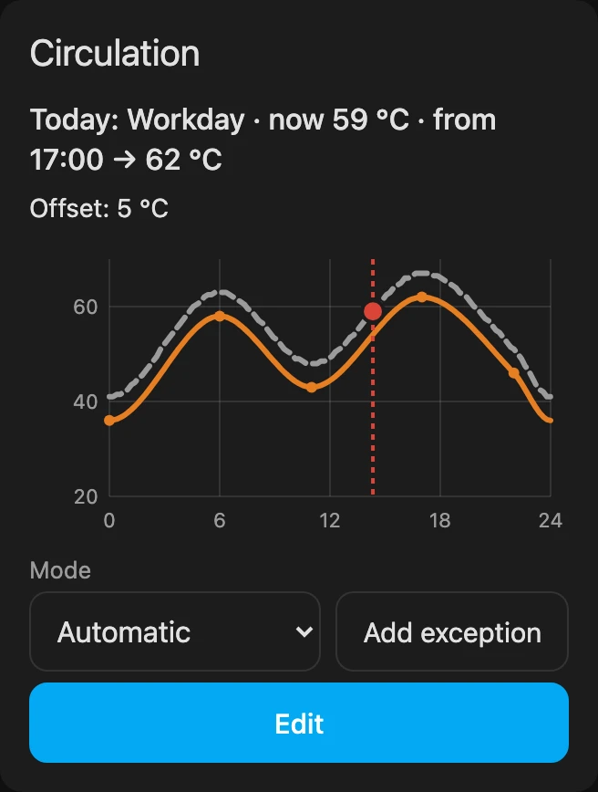
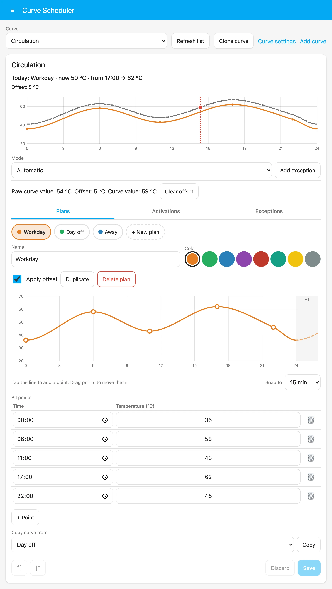
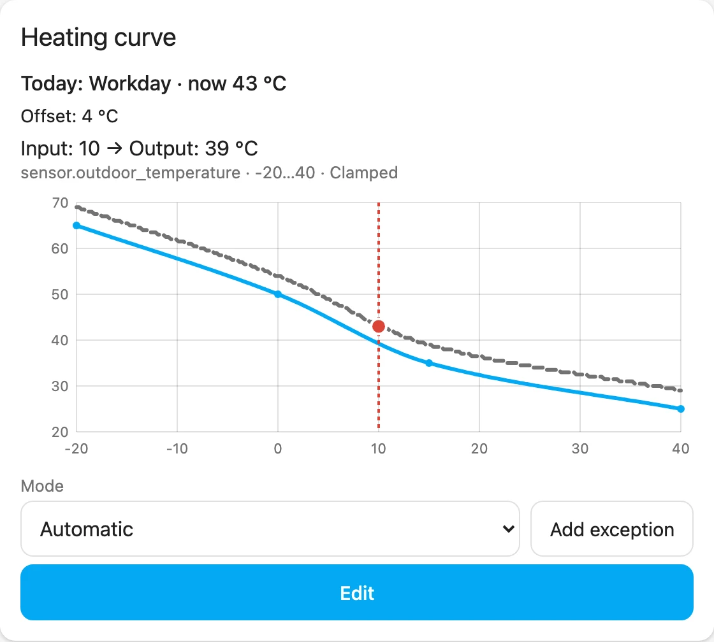

# Curve Scheduler

Home Assistant integration: curve schedules with a visual, touch-friendly editor card

> **Fork and attribution:** This is an independently maintained fork of
> [timzifer/ha-curve-scheduler](https://github.com/timzifer/ha-curve-scheduler).
> Thank you to Tim ([@timzifer](https://github.com/timzifer)) and the original
> contributors for the integration, visual editor and foundation for this work.
> This fork is maintained by Jonas Poessl ([@poessl](https://github.com/poessl)).
> The original MIT license and copyright attribution are preserved in [LICENSE](LICENSE).

> **AI development advisory:** Development of this fork has made heavy use of AI
> assistance through **Codex with GPT-6.1 sol**. Review the configuration and test
> your curves before letting them control equipment; AI assistance is not a
> guarantee of correctness.

**Requires Home Assistant 2026.11.3 or newer.** The integration domain remains
`curve_scheduler`: install this fork in place of the original, not alongside it.

[](https://github.com/poessl/ha-curve-scheduler/actions/workflows/validate.yml)
[](https://github.com/poessl/ha-curve-scheduler/actions/workflows/ci.yml)
[](https://my.home-assistant.io/redirect/hacs_repository/?owner=poessl&repository=ha-curve-scheduler&category=integration)

🇩🇪 [Deutsche Anleitung](README.de.md)

**Curve Scheduler** turns a curve into a numeric setpoint. Its input can be the
**time of day**, a **sensor value** (for example outdoor temperature), the
**day of week**, or the **month of year**. Use it for hot-water circulation, heating curves, seasonal
temperatures or other numeric controls. It writes to an optional target entity;
without a target, its sensors provide values for your own automations.

Define a few **points** and choose how values between them are interpolated.
Keep several **plans** such as *Workday*, *Day off* and *Away*. Ordered conditions
choose the active plan, with date exceptions and manual overrides when needed.
Edit in the **sidebar** or a **dashboard card**, using touch, mouse, exact fields
or the keyboard. Everyday schedule editing does not require admin rights.

<p align="center">
  
  
</p>

Screenshots use deterministic local demo data. The solid colored line is the
unadjusted plan; the gray dashed line is the output with a **+5 °C offset**.
The red marker shows the current input.

[User guide](#user-guide): [Installation](#installation) · [Setup](#setup-once-by-an-administrator) ·
[Editing](#editing-in-the-sidebar-or-card) · [Offsets](#keep-manual-target-adjustments) ·
[Weekly, sensor and seasonal curves](#use-a-weekly-sensor-or-seasonal-curve) · [Actions](#actions-services)

[Developer guide](#developer-guide): architecture, APIs, local development and screenshot generation.

## User guide

### Features

- Shared curve editor for time-of-day, day-of-week, month and sensor inputs: drag points with mouse or finger, or type the values into fields
- Numeric axes can clamp at their limits or wrap periodically, including sensor inputs
- Four kinds of transition: step, linear, smooth and curve (monotone cubic, never overshoots)
- Ordered activations by weekday, month, time of day, holiday calendar/Workday sensor or entity state/attribute (exact or numeric), with AND/OR/NOT groups and date-range exceptions
- Optional target watching retains manual adjustments as an additive offset; each plan can opt out
- Manual plan selection through the card or select entity; optional expiry through an action
- Undo/redo, *Save*/*Discard* and a warning about unsaved changes
- Several cards can be open at the same time; changes appear everywhere, and conflicting saves are detected
- Writes to `number`, `input_number`, `climate` or `water_heater` entities
- Sidebar editor plus compact, full and graph-only dashboard cards; English/German, light/dark themes and layouts from 320 px

### Installation

#### HACS (recommended)

[Open this fork in HACS](https://my.home-assistant.io/redirect/hacs_repository/?owner=poessl&repository=ha-curve-scheduler&category=integration), or add it manually:

1. Open **HACS** → menu (⋮) → **Custom repositories**.
2. Add `https://github.com/poessl/ha-curve-scheduler` with the category **Integration**.
3. Search for **Curve Scheduler**, install it, then restart Home Assistant.

#### Manual

Copy `custom_components/curve_scheduler` into the `custom_components` folder of
your Home Assistant configuration and restart.

The dashboard card is part of the integration and is registered
automatically. You do **not** have to add a dashboard resource.

### Setup (once, by an administrator)

**Settings → Devices & services → Add integration → Curve Scheduler**

First choose a name, optional target and X-axis source. The next step groups the
remaining settings under Input, Target, Output and Graph, showing the fields for
your selected input. **Configure** also asks for the axis source before its settings.

| Setting | Meaning | Default |
|---|---|---|
| Name | e.g. "Circulation" | – |
| Target | Optional: `number`, `input_number`, `climate` (attribute `temperature`) or `water_heater` | – |
| Output tick | seconds between input sampling and output updates (1–86400) | 300 |
| X-axis source | time of day / day of week / month of year / sensor | time of day |
| Input entity | numeric state from `sensor`, `input_number` or `number`; required for a sensor axis | – |
| X minimum / maximum | numeric axis limits (upper limit exclusive when wrapping) | sensor: 0 / 100; week: 1 / 8; month: 1 / 13 |
| X point resolution | snapping for point movement; input samples are not rounded | sensor: 0.1; week/month: 0.01 |
| Wrap input | periodic continuation; otherwise clamp out-of-range input | sensor: off; week/month: on |
| Transition between points | step / linear / smooth / curve | curve |
| Minimum / Maximum | allowed range; also the chart's axis | taken from the target, else 20 / 70 |
| X-axis label interval | 0 = automatic; otherwise minutes for time of day, X units for numeric inputs | 0 |
| Y-axis label interval | 0 = automatic; otherwise output units | 0 |
| Rounding step | value is rounded before writing | 0.5 |
| Unit | shown in the card | taken from the target |
| Watch target changes as offset | retain external target adjustments until cleared | off |
| Write threshold | only write when the value changed by at least this much | 0 |

All settings can be changed later under **Configure**. You can add as many
instances as you like (e.g. circulation and buffer tank). Two example plans,
*Workday* and *Day off*, are created on setup.

> **Workday sensor:** the Workday integration also reports weekends as
> "not a workday". If Saturday and Sunday should use their own plans from the
> activation entries, put the weekday entries first or set up the Workday sensor with all seven days as workdays, so
> it only reports public holidays.

#### Open the sidebar editor

Open **Curve Scheduler** in the Home Assistant sidebar and choose a curve from
the list at the top. You do not need to create a dashboard card.

- **Plans:** create and edit the curves you want to use.
- **Activations:** choose when each plan applies, with the first matching entry taking priority.
- **Exceptions:** choose a different plan for a date range, such as a holiday or trip.

Click **Save** to apply your changes. You can undo edits or discard them before
saving. The editor asks before you leave with unsaved changes.

To change a curve's input, target, limits, or update interval, open **Curve
settings**, then **Configure** for that curve. Administrators can also use
**Add curve** or **Clone curve**. Use **Refresh list** if a newly added curve
has not appeared yet.



#### Clone a whole curve

Administrators can select a curve in the sidebar editor and click **Clone curve**.
Enter the new name, then confirm. The editor opens the independent copy.

The copy includes your saved settings, all plans and colors, activations, and
exceptions, automatic cleanup setting, stored offset and each plan’s offset toggle. You can edit or delete either curve independently.

The copy starts **disabled** and in **Automatic** mode. It keeps the same input
and target as the original: check **Curve settings → Configure** before enabling it.

#### Add the card (optional)

Edit a dashboard → **Add card** → **Curve Scheduler**, then select an instance.
Choose **Compact** (today with an editor button), **Full** (editor open), or
**Graph only** (chart with information and controls hidden by default).

| Card option | Effect |
|---|---|
| `entry_id`, `title` | Instance to show; optional title override |
| `view: compact / full / graph` | Defaults for editor and information visibility |
| `editor_mode: hidden / button / always` | Hide editor, open with Edit, or keep open; overrides view defaults |
| `show_controls` | Mode selector and action buttons; independent of the editor and Edit button |
| `show_title`, `show_summary`, `show_reason` | Title, current/next value summary, and plan-selection reason |
| `show_input` | Input readout on numeric graphs |
| `show_offset` | Stored nonzero offset readout; does not hide the dashed output curve |
| `show_clear_offset` | Separate reset button above the graph; default off |
| `allow_edit` | Allow non-admin users to open this card's editor; default on |

All information toggles default on in Compact/Full and off in Graph only.
Explicit settings override those defaults. The sidebar uses the same editor in
Always open mode. Legacy `show_edit: false` hides the editor unless an explicit
`editor_mode` is set.

For example, show a graph with just its title, offset and reset button:

```yaml
type: custom:curve-scheduler-card
entry_id: YOUR_CONFIG_ENTRY_ID
view: graph
show_title: true
show_offset: true
show_clear_offset: true
```

**Access:** these are display preferences, not backend permissions. Any signed-in
HA user can read and edit schedules through the integration API. Administrators
can still edit when `allow_edit: false`; setup, configuration and whole-curve
cloning require admin rights.

### Editing in the sidebar or card

#### Today


The chart shows today's plan and, when applicable, its dashed offset-adjusted
output. The red line marks the current time. The summary shows the current
adjusted value and the next planned point; the next point belongs to the
unadjusted plan.

- **Mode:** *Automatic* follows the ordered activations. Choosing a plan uses it until you switch back to *Automatic*.
- **Add exception:** enter a date range and the plan to use during that time.
- **Edit** opens the editor.

<br clear="right">

#### Plans

<p>
  
  
</p>

- Choose the plan at the top. **+ New plan**, rename, pick a color, **Duplicate** or **Delete plan**.
  A plan used as fallback, in an activation, or in an exception cannot be deleted; the card says where it is used.
- **Drag a point** to change time and value. Points snap to 15 minutes (adjustable) and the rounding step, and cannot pass their neighbors. A label shows time and value while dragging.
- **Tap the line** to add a point there.
- **Tap a point** to select it. Below the chart you can type the time and value, use − / +, or delete it.
- The **table of all points** offers the same without dragging: change times and values, delete points, **+ Point**.
- On time curves, the dashed continuation beyond the day shows the transition to the next day; it is distinct from the gray offset line in the main graph.
- **Apply offset** controls whether this plan uses the stored adjustment. The editing graph always shows the original points.
- **Copy curve from** copies all points from another plan.
- With a point selected, use the arrow keys to adjust it, **Delete/Backspace** to remove it, or **Escape** to deselect it. **Space** adds a point when you are not typing in a field.

Time points use a five-minute storage grid; drag snapping defaults to 15 minutes.
Each plan supports 1–48 points, with up to 20 plans per instance. Duplicate times
or X coordinates and values outside the configured range are rejected on save.
Use one point for a constant plan.

#### Activations


Add an activation entry and choose its target plan. Use **Day of the week** or
**Holiday calendar** directly, or choose **Custom condition** and a condition type:

- **Day of the week:** check one or more weekdays in the dropdown. The entry matches any selected day.
- **Holiday calendar:** choose a calendar or Workday binary sensor here, rather than in the main configuration. Any calendar event marks a day off; a Workday sensor matches when it is `off`.
- **Entity state (exact text):** choose an entity, optionally an attribute, and the expected
  value. Entity states are text; attribute values have an explicit Text, Number
  or Boolean type. For boolean attributes use `true` or `false`.
- **Numeric value:** choose an entity and optional attribute, then set Above
  and/or Below. Bounds are exclusive: above 4 and below 6 matches 5 or 5.0,
  but not 4 or 6. Exact state matching compares text: `5` differs from `5.0`.
- **Month of year:** check one or more months, January through December. A
  single selection is enough to match; at least one month must be selected.
- **Time of day:** set **After (inclusive)** and/or **Before (exclusive)** in HA
  local time. For example, 08:00–18:00 includes 08:00 but excludes 18:00. An
  overnight range such as 22:00–06:00 includes late evening and early morning.
  Clear one bound for an open-ended range. Conditions are reevaluated on output
  updates; a boundary does not schedule a separate write, so the output tick
  determines the normal response delay.
- Choose **AND**, **OR** or **NOT** as the condition type to combine rules. Groups
  can contain all the types above, including nested groups. NOT
  matches only when none of its children match. Add or remove child conditions
  inside the group. Entity changes update the selected plan automatically.

For example, choose **Custom condition → AND**, add **Month of year** with
November, December, January and February, then **Time of day** from 22:00 to
06:00. Assign your night plan to that entry and choose a fallback plan for other
times. This selects a plan; it does not change the curve’s X-axis.

The calendar and curve previews use backend condition evaluation, including
unsaved changes. Weekday, month and holiday conditions use the requested date.
Entity conditions use current states, and time-of-day conditions use HA’s current
local clock even when previewing another date or a curve point. The previews do
not simulate future entity changes or intraday plan switches.

Separate activation entries are alternatives;
combine entity and weekday conditions in one AND group when both must match.
Missing entities or attributes do not satisfy a leaf condition. Logical groups
still follow AND/OR/NOT semantics: a NOT around a false condition can match.

The **first matching entry wins**. Reorder entries using ↑/↓ or drag and drop.
If nothing matches, the plan selected under **Fallback plan** applies. The month overview shows the resulting
plans, with holidays (★) and date exceptions (✈).

Existing weekday assignments and holiday settings migrate automatically, with the
holiday activation first to preserve its former priority. Existing numeric curves
are copied into each plan so migration preserves the current output.

#### Exceptions

Each exception has an inclusive **From / To** date range, a plan and an optional
note. If exceptions overlap, the first matching exception in the saved list wins.
Past entries are grayed out; remove them with **Remove past entries** or enable automatic
cleanup. A manual plan override takes priority over exceptions.


#### Saving

Changes take effect only after **Save**. **Undo** and **Redo** step through
your changes; **Discard** drops all of them. If somebody else saved in the
meantime, the card shows *"Changed in the meantime – reload?"*.

After saving, the output is recalculated and applied immediately when enabled
and the input and target are available.

### Keep manual target adjustments

Enable **Watch target changes as offset** under **Curve settings → Configure**.
When you change a target's numeric setpoint externally, Curve Scheduler stores
its difference from **Raw curve value** as **Offset**. For example, a raw value
of 45 °C changed to 48 °C creates +3 °C. When the raw curve later reaches 50 °C,
the adjusted **Curve value** is 53 °C. Another external adjustment replaces the
offset; it does not add the same adjustment twice.

The offset applies equally across plans without changing their points. Under
**Plans**, turn **Apply offset** off for a plan that should use its unadjusted
value. This retains the stored offset, which applies again on other opted-in
plans. The toggle defaults to on.

Use **Clear offset** in the card or sidebar, or the `curve_scheduler.clear_offset`
action, to return to the unadjusted curve. Offsets survive saving, plan changes,
disabling and HA restarts. Turning watching off stops capturing adjustments but
keeps the existing offset. Clones copy it and start disabled. Changing the target
also retains it; clear it if the new target should start unadjusted.

Watching captures changes while the curve is enabled and both input and target
are available. Changes made while HA is offline are not captured on startup.
Climate and water-heater targets use their temperature setpoint attribute.
The unadjusted sensor is already bounded and rounded; the offset is added before
final limits and rounding. Its `raw_value` attribute remains unrounded interpolation.

If a device drops HA context and acknowledges a differently rounded value,
watching may interpret that as an external change. Use an output rounding step
compatible with the device's supported precision. The main graph shows the unadjusted plan plus a gray dashed line for the
offset-adjusted output whenever a nonzero offset applies. Plans with Apply offset
off show only the unadjusted line. The editor graph always edits the unadjusted
plan; the value labels show the retained adjustment and actual output.

### How the value is calculated

- A plan describes a day from 00:00 to 24:00. **Across midnight** the curve
  runs towards the first point of the **next day's plan**, so switching from
  workday to weekend does not cause a jump (except in *step* mode).
- Priority for a day: **manual mode > date exception > first matching activation > configured fallback plan**.
- *Curve* uses monotone cubic interpolation (PCHIP, Fritsch–Carlson). It goes
  through every point, never overshoots and has no kinks. *Smooth* uses
  smoothstep between two points.
- Calculation uses local wall-clock time. At a daylight saving change, an hour
  may be skipped or repeated. This follows local wall-clock time, rather than
  stretching the curve into a fixed elapsed duration; the affected hour depends on your timezone.
- The value is clamped to min/max and rounded to the step before writing.

### When is the value written?

- every *output tick* (seconds, measured from integration startup); legacy entries retain their minute interval until configured,
- immediately on: Home Assistant start (as soon as the target is available), *Save*,
  changing the mode, a change of a holiday/activation source, switching the instance on, and the *Apply now* button,
- sensor-input changes also recalculate immediately, with normal write-threshold handling,
- only if the value differs from the target's current value; periodic writes also respect the *write threshold*,
- never while the instance is switched off (the sensor still shows the computed value),
- not while the target is `unavailable`/`unknown`: one warning is logged, and the value is written as soon as the target is back.

### Entities

Each instance creates a device **Curve Scheduler &lt;name&gt;** with:

| Entity | Purpose |
|---|---|
| `sensor.<name>_setpoint` | Raw curve value before offset (existing entity ID retained); attributes `profile`, `reason` (weekday/holiday/condition/exception/override/fallback), `next_point_time`, `next_point_value`, `value_in_1h` |
| `sensor.<name>_curve_value` | Curve value after offset, limits and rounding; value sent to the target |
| `sensor.<name>_offset` | persisted additive offset in output units |
| `sensor.<name>_profile` | name of the active plan |
| `switch.<name>_active` | instance on/off |
| `select.<name>_mode` | `auto` (Automatic) or a plan (manual mode) |
| `button.<name>_apply_now` | write now |

Entity IDs above are examples: HA generates them from names and translations,
and they can be renamed. The existing setpoint entity retains its identity.
Its `raw_value` attribute is the interpolation before output limits and step
rounding (reported to four decimals); the sensor state is bounded and rounded.
`next_point_*` and `value_in_1h` describe the unadjusted curve. Non-time-of-day
axes have no next time point; the one-hour value advances calendar inputs but
reuses the current sensor reading and live condition assumptions. Both value sensors become unavailable for
an invalid input; the offset remains readable.

Mode, switch, offset and all saved plans survive restarts.

### Use a weekly, sensor or seasonal curve

A curve can follow the progress of a week, a sensor reading or the time of year
instead of the time of day. Plans, activations, exceptions and **Automatic** mode
work for all four input types.

| X-axis source | Coordinates and behavior |
|---|---|
| Time of day | One daily curve; connects to the next day's selected plan across midnight |
| Day of week | Monday = 1 through Sunday = 7, with fractions for time within each day; default range [1, 8), wrapping to Monday |
| Month of year | January = 1 through December = 12, with progress through each month's actual length; default range [1, 13), wrapping to January |
| Sensor | Current numeric entity state; default range 0–100, clamped unless wrapping is enabled |

Calendar inputs use HA local time and need no input entity. X point resolution
snaps edits, not the running input: the default 0.01 on a week axis is 14.4
minutes. With wrapping, the upper limit is excluded; use 1 rather than 8 for the
Monday boundary. Without wrapping, the curve holds its endpoint values.

<p>
  
  
</p>

These examples show smooth heating and seasonal plans with a +4 °C adjustment.
The summary and dashed curve show the adjusted output; the numeric graph's
**Input → Output** readout shows the unadjusted curve value.

#### Example: an outdoor-temperature heating curve

1. Click **Add curve**, name it **Heating curve**, and choose **Sensor value**.
2. Select your outdoor-temperature sensor. Set the input range to **−20 to 40**
   and the output range to **20 to 70 °C**. Choose **Linear** for the transition.
3. In **Plans**, set two points: **−20 → 70** and **40 → 20**, then save.
4. At an outdoor temperature of **10 °C**, the calculated setpoint is **45 °C**.

You can leave **Target** empty to try the curve and use its setpoint sensor in
your own automations. Select a target when you want the curve to control a device.
If the input sensor is unavailable, the curve stops sending values until it returns.

#### Example: one continuous weekly curve

1. Choose **Day of week** when adding or configuring a curve. Keep X minimum
   **1**, maximum **8** and **Wrap input** enabled.
2. In one plan, add points such as **1 → 40**, **1.5 → 55**, **6 → 45** and
   **7.5 → 50**. Choose **Linear** to make the transitions easy to inspect.
3. Monday at midnight uses X = **1**; Monday noon uses **1.5**; Sunday noon
   uses **7.5**. The curve then continues towards Monday's point at the wrap.

The chart labels weekdays and includes the time for fractional coordinates;
exact point fields still use numeric X values. A weekly curve describes a whole
week in each plan. A **Weekday** activation instead selects which plan to use on
a date. Keep the same plan active throughout the week for a single continuous
weekly shape; selecting another plan can change the output immediately.

#### Stop at the limits or repeat

Leave **Wrap input** off for temperature and similar readings: inputs outside
the range use the nearest end of the curve. Turn it on for repeating values,
such as an angle that returns to zero after a full rotation.

Choose **Month of year** for a seasonal curve. January is **1**, February **2**,
and December **12**. The curve moves gradually between months and, with wrapping
enabled, continues from December back to January.

#### Make the graph easier to read

Under **Curve settings → Configure**, adjust the X- and Y-axis label intervals
if you want more or fewer labels; **0** chooses them automatically. Point
resolution controls how far points move when you drag them. Both time and numeric
curves support dragging, exact values in fields, and keyboard editing.

### Actions (services)

| Action | Fields |
|---|---|
| `curve_scheduler.set_override` | `config_entry_id`, `profile` (name or id), optional `until` |
| `curve_scheduler.clear_offset` | `config_entry_id`; persist zero offset and apply the curve value |
| `curve_scheduler.clear_override` | `config_entry_id` |
| `curve_scheduler.add_exception` | `config_entry_id`, `from`, optional `to`, `profile`, optional `note` – returns `exception_id` |
| `curve_scheduler.remove_exception` | `config_entry_id`, `exception_id` **or** `date` |
| `curve_scheduler.apply_now` | `config_entry_id` |

Choose the integration instance in the action editor to obtain its
`config_entry_id`; this is not an entity ID. `profile` accepts a saved plan name
or ID. An override without `until` stays active until cleared. With `until`,
use a future date/time; the integration returns to automatic selection on expiry.
If `to` is omitted for an exception, it applies for one day.

Example: use a plan named **Away** while nobody is at home.

```yaml
automation:
  - alias: Hot water – away
    triggers:
      - trigger: state
        entity_id: group.family
        to: not_home
        for: "24:00:00"
    actions:
      - action: curve_scheduler.set_override
        data:
          config_entry_id: 01J...   # pick the instance in the UI editor
          profile: Away
```

## Developer guide

### Architecture and compatibility

| Location | Responsibility |
|---|---|
| `custom_components/curve_scheduler/` | Config flows, validated model, storage, runtime, entities, actions and WebSocket API |
| `frontend/src/` | Shared Lit card/sidebar editor, conditions UI and TypeScript interpolation |
| `frontend/demo/` | Isolated fixtures and reproducible screenshot capture |
| `tests/`, `frontend/test/` | Backend and frontend regressions; shared interpolation vectors in `tests/vectors/` |
| `docs/` | Behavior contracts, acceptance checks and feature coverage |

Saved plans and runtime settings use Home Assistant storage helpers. Existing
weekday/holiday assignments migrate into ordered activations; numeric curves
migrate into every plan. Do not edit `.storage` directly.

The runtime computes plan selection and output; the schedule model validates JSON
and the HA storage helper persists it. Native HA condition validation and logical
evaluation are reused with date-aware weekday/month/holiday adapters. Native time
conditions retain live-clock semantics; previews do not inject a simulated time. The shared editor
provides the supported condition controls; native automation editor embedding is
not included. See [condition integration](docs/CONDITIONS.md) and the
[offset contract](docs/OFFSET.md) for implementation details and limitations.

The interpolation exists twice, in Python (backend) and TypeScript (card
preview). Both are tested against the same vector file
(`tests/vectors/interpolation.json`, tolerance 1e‑6). The backend remains
authoritative for condition resolution and target output.

### WebSocket API

The card and sidebar use these commands. All require an authenticated HA user;
only cloning additionally requires admin rights.

| Command | Purpose |
|---|---|
| `curve_scheduler/list` | all instances |
| `curve_scheduler/get` | configuration, plans, revision, live state |
| `curve_scheduler/save` | save plans (`revision` for conflict detection); returns translatable validation errors |
| `curve_scheduler/subscribe` | live updates |
| `curve_scheduler/preview` | backend-computed curve of a day (optionally for unsaved plans) |
| `curve_scheduler/calendar` | backend-resolved automatic plans for a date range, including draft conditions |
| `curve_scheduler/holidays` | days off from the holiday source in a date range |
| `curve_scheduler/clone` | independent whole-curve copy; admin only |

### Setup and validation

Use Python 3.14.2+ (3.14 series) and Node.js 24. Development and tests pin
Home Assistant and the official `pytest-homeassistant` fixtures to the same
2026.11.3 release; upgrade those two pins together.

```bash
# backend
pip install -r requirements_dev.txt
ruff check . && ruff format --check . && mypy custom_components/curve_scheduler
pytest

# card
cd frontend
npm ci
npm run lint && npm run typecheck && npm test
npm run build         # writes custom_components/curve_scheduler/frontend/curve-scheduler-card.js
npm run demo          # demo page with a fake backend on http://localhost:8765/demo/

# shared interpolation vectors (after changing the algorithm)
python scripts/generate_vectors.py
```

For the local Compose instance (Home Assistant 2026.11.3):

```bash
mkdir -p dev/config
# First run only; preserve existing runtime configuration on later runs:
cp -n config/configuration.yaml dev/config/configuration.yaml
docker compose up -d
```

Open <http://localhost:8124>. This uses port 8124 to coexist with the separate
Schedule2D dev instance on 8123. Override with `CURVE_SCHEDULER_PORT` if needed.
The integration and built card are mounted from this checkout; restart the service
after backend changes. Private HA data stays in ignored `dev/config/`.

The repository contains a devcontainer. `scripts/develop` starts a local Home
Assistant with the integration on port 8123 (see `config/configuration.yaml`).
[docs/ACCEPTANCE.md](docs/ACCEPTANCE.md) documents the acceptance test.

Releases: publishing a GitHub release builds the card, sets the version in
`manifest.json` from the tag and attaches `curve_scheduler.zip`, which HACS installs.

### Refresh the README screenshots

The demo never connects to Home Assistant. After `npm ci` in `frontend/`, install
Chromium with `npx playwright install chromium`. Provide Python with Pillow
installed (`PYTHON=/path/to/python` when needed).

```bash
# terminal 1, from frontend/
npm run demo
# terminal 2, from frontend/
npm run screenshots
```

The capture script produces English **and German** WebP images: light/dark,
desktop/mobile, sidebar, plans, activations, exceptions, sensor and seasonal
curves. It fixes the browser timezone to Europe/Berlin and waits for the offset
path before graph captures. Demo time and values are fixed in `demo/demo.ts`;
`DEMO_URL` can select a different local server.

[Feature coverage](docs/FEATURE_COVERAGE.md) maps the implementation to this guide.
[Acceptance checks](docs/ACCEPTANCE.md) and `TASKS.md` record verification work;
documentation coverage does not imply that every manual scenario has been tested.

## License

[MIT](LICENSE), including the original copyright © 2026 Tim.
