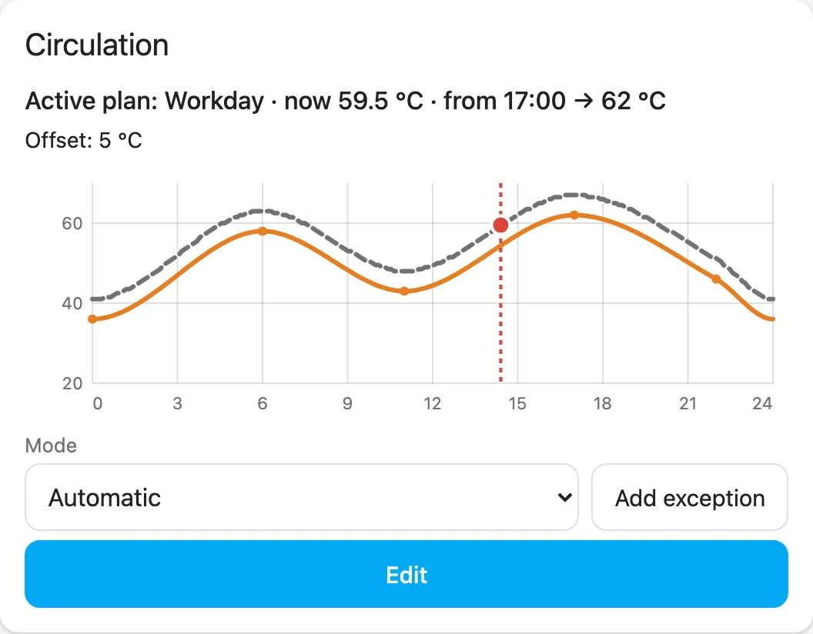
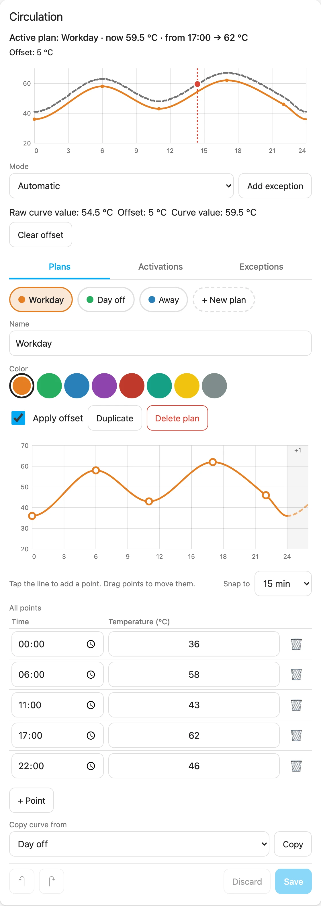
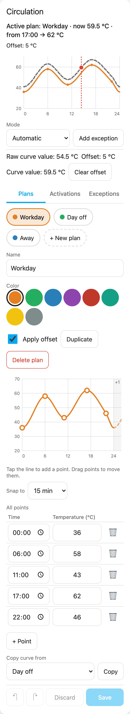
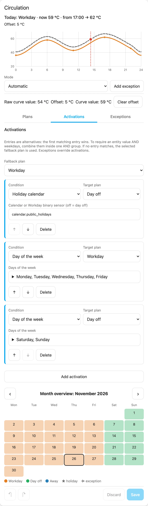
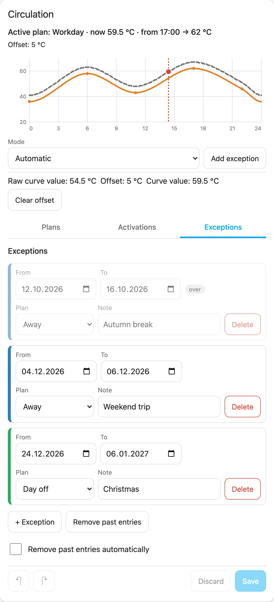
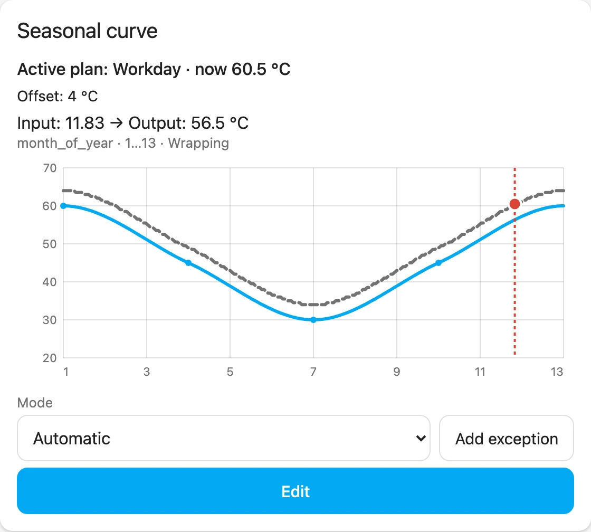
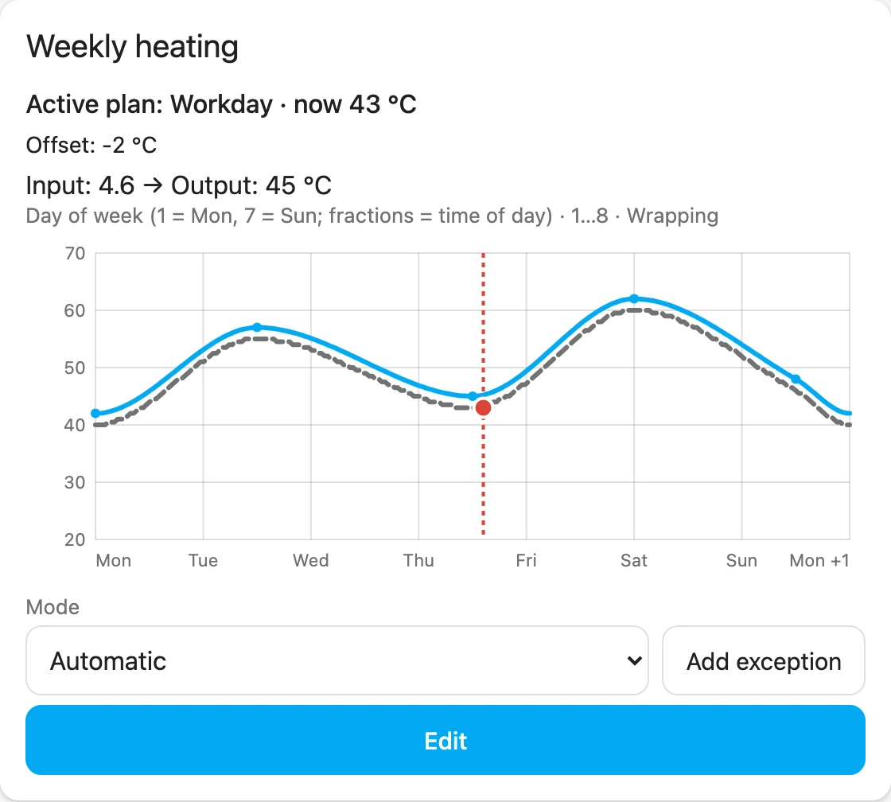

# Curve Scheduler

Curve Scheduler creates numeric schedules and heating curves for Home Assistant.
Draw points to set how a value changes with **time of day**, **day of week**,
**month of year**, or a **sensor reading**. Send the result to a target entity,
or use the output sensors in your own automations.

Keep plans such as *Workday*, *Day off*, and *Away*, and choose when each applies.
Edit them in the sidebar or on a dashboard, using touch, mouse, or keyboard.

**Requires Home Assistant 2026.11.3 or newer.** This is an independently maintained
fork of [timzifer/ha-curve-scheduler](https://github.com/timzifer/ha-curve-scheduler).
The integration domain remains `curve_scheduler`: install this fork in place of
the original, not alongside it.

[](https://github.com/poessl/ha-curve-scheduler/actions/workflows/validate.yml)
[](https://github.com/poessl/ha-curve-scheduler/actions/workflows/ci.yml)
[](https://my.home-assistant.io/redirect/hacs_repository/?owner=poessl&repository=ha-curve-scheduler&category=integration)

<p align="center">
  
  
</p>

## Contents

- [Features](#features)
- [Getting started](#getting-started) — install and edit your first plan
- [Everyday use](#everyday-use) — editing, activations, exceptions, offsets, and cards
- [Reference](#reference) — settings, curve behavior, entities, and actions
- [Developer guide](#developer-guide) — setup, architecture, checks, and APIs
- [Project information](#project-information) — attribution, support, and license

## Features

- **Curves:** four input types; step, linear, smooth, or curve interpolation;
  transitions across midnight; clamped or repeating numeric inputs.
- **Plan selection:** weekday, month, time, holiday/Workday, entity-state, and
  numeric conditions, combined with AND/OR/NOT. Date exceptions and manual
  overrides take priority; overrides can expire through an action.
- **Editing:** drag points or enter exact values, duplicate plans, undo/redo,
  and save/discard. Changes appear in other open editors; conflicting saves
  are detected.
- **Output:** control `number`, `input_number`, `climate`, or `water_heater`
  entities, or use sensors alone. Retain manual target adjustments as an offset,
  with a choice of which plans use it.
- **Interface:** sidebar editor and compact, full, or graph-only dashboard cards;
  English/German UI, light/dark themes, and phone layouts.

## Getting started

### Installation

#### Install with HACS (recommended)

[Open this fork in HACS](https://my.home-assistant.io/redirect/hacs_repository/?owner=poessl&repository=ha-curve-scheduler&category=integration), or add it manually:

1. Open **HACS** → menu (⋮) → **Custom repositories**.
2. Add `https://github.com/poessl/ha-curve-scheduler` with the category **Integration**.
3. Search for **Curve Scheduler**, install it, then restart Home Assistant.

#### Install manually

Copy `custom_components/curve_scheduler` into the `custom_components` folder of
your Home Assistant configuration and restart.

The dashboard card is part of the integration and is registered
automatically. You do **not** have to add a dashboard resource.

### Create a curve

As an administrator, open **Settings → Devices & services → Add integration →
Curve Scheduler**.

1. Choose a name, an optional **Target**, and the **X-axis source**. Choose
   **Time of day** for a daily schedule. Leave Target empty to try a curve
   without controlling a device.
2. Set output limits and units. See [settings and defaults](#settings-and-defaults)
   for the remaining options.
3. Complete setup. Two example plans, *Workday* and *Day off*, are created.

### Edit and check your first plan

1. Open **Curve Scheduler** in the Home Assistant sidebar and select your curve.
   A dashboard card is optional.
2. Under **Plans**, select *Workday*. Drag a point or select it and type its time
   and value below the chart. The point table also supports editing without dragging.
3. Under **Activations**, check which days or conditions select each plan and
   choose the fallback plan. **Exceptions** can select a plan for a date range.
4. Click **Save**.
5. Check the active plan and **Curve value** in the summary or the curve's
   [entities](#entities). Saving applies the value immediately when the curve is
   enabled and its input and target are available.


To change the input, target, limits, or output tick later, use **Curve settings →
Configure**. Administrators can also **Add curve** or **Clone curve**. Use
**Refresh list** if a newly added curve has not appeared yet.

## Everyday use

Each curve has its own settings and plans. A plan is a set of points; activations
and exceptions choose which plan to use. Any signed-in HA user can edit plans.
Adding, configuring, and cloning a curve require administrator rights.

### Active plan


The chart shows the active plan and a dashed output line when an offset applies.
On time curves, the red line marks the current time. The summary shows the current
output and the next planned point, whose value excludes the offset.

- **Mode:** *Automatic* follows the ordered activations. Choosing a plan uses it until you switch back to *Automatic*.
- **Add exception:** enter a date range and the plan to use during that time.
- **Edit** opens the editor.

<br clear="right">

### Plans

<p>
  
  
</p>

- Choose a plan at the top to rename it, change its color, duplicate, or delete it.
  Use **+ New plan** to add one. Before deleting a plan, remove its references
  from activations, exceptions, or the fallback setting.
- **Drag a point** to change its time or X coordinate and value. Time curves snap
  to 15 minutes by default (adjustable); numeric curves use the configured X point
  resolution. Values snap to the rounding step. Points cannot pass their neighbors.
- **Tap the line** to add a point there.
- **Tap a point** to edit its coordinates below the chart, use − / +, or delete it.
- Use the **point table** to edit, add, or delete points without dragging.
- On time curves, the dashed continuation beyond the day shows the transition
  to the next day.
- **Apply offset** chooses whether this plan uses the stored adjustment.
  The editing graph always shows the original points.
- **Copy curve from** copies all points from another plan.
- With a point selected, use the arrow keys to adjust it, **Delete/Backspace** to remove it, or **Escape** to deselect it. **Space** adds a point when you are not typing in a field.

Time points must be on a five-minute grid. Each plan supports 1–48 points,
with up to 20 plans per curve. Duplicate times
or X coordinates and values outside the configured range are rejected on save.
Use one point for a constant plan.

### Activations



Add an activation entry and choose its target plan. Use **Day of the week** or
**Holiday calendar** directly, or choose **Custom condition** and a condition type:

- **Day of the week:** select the days on which the entry applies.
- **Holiday calendar:** choose a calendar or Workday binary sensor. Any calendar
  event marks a day off; a Workday sensor matches when it is `off`.
- **Entity state (exact text):** choose an entity, optionally an attribute, and the expected
  value. Entity states are text; attribute values have an explicit Text, Number
  or Boolean type. For boolean attributes use `true` or `false`.
- **Numeric value:** choose an entity and optional attribute, then set Above
  and/or Below. Bounds are exclusive: above 4 and below 6 matches 5 or 5.0,
  but not 4 or 6. Exact state matching compares text: `5` differs from `5.0`.
- **Month of year:** select one or more months on which the entry applies.
- **Time of day:** set **After (inclusive)** and/or **Before (exclusive)** in HA
  local time. For example, 08:00–18:00 includes 08:00 but excludes 18:00. An
  overnight range such as 22:00–06:00 includes late evening and early morning.
  Clear one bound for an open-ended range. These conditions are checked on output
  updates, so a plan change can be delayed by up to one output tick.
- Choose **AND**, **OR** or **NOT** as the condition type to combine rules. Groups
  can contain all the types above, including nested groups. NOT matches when
  none of its children match. Entity changes update plan selection automatically.

For example, choose **Custom condition → AND**, add **Month of year** with
November, December, January and February, then **Time of day** from 22:00 to
06:00. Assign your night plan to that entry and choose a fallback plan for other
times. This selects a plan; it does not change the curve’s X-axis.

Previews include unsaved changes. Weekday, month, and holiday conditions use the
date being previewed; entity and time conditions use current states and HA’s
current local clock. Previews do not predict entity changes or simulate plan
switches within a day.

Separate activation entries are alternatives;
combine entity and weekday conditions in one AND group when both must match.
Missing entities or attributes do not satisfy a leaf condition. Logical groups
still follow AND/OR/NOT semantics: a NOT around a false condition can match.

The **first matching entry wins**. Reorder entries using ↑/↓ or drag and drop.
If nothing matches, the plan selected under **Fallback plan** applies. The month
overview shows the resulting plans, with holidays (★) and date exceptions (✈).

> **Workday sensor:** the Workday integration also reports weekends as
> "not a workday". If Saturday and Sunday should use their own plans from the
> activation entries, put the weekday entries first or set up the Workday sensor
> with all seven days as workdays, so it only reports public holidays.

### Exceptions

Each exception has an inclusive **From / To** date range, a plan and an optional
note. If exceptions overlap, the first matching exception in the saved list wins.
Past entries are grayed out; remove them with **Remove past entries** or enable
automatic cleanup. A manual plan override takes priority over exceptions.



### Saving

Changes take effect only after **Save**. **Undo** and **Redo** step through
your changes; **Discard** drops all of them. The editor asks before you leave
with unsaved changes. If somebody else saved in the meantime, the card shows
*"Changed in the meantime – reload?"*.

After saving, the output is recalculated and applied immediately when enabled
and the input and target are available.

### Keep manual target adjustments

Enable **Watch target changes as offset** under **Curve settings → Configure**.
When you change a target's numeric setpoint externally, Curve Scheduler stores
its difference from **Raw curve value** as **Offset**. For example, a raw value
of 45 °C changed to 48 °C creates +3 °C. When the raw curve later reaches 50 °C,
the adjusted **Curve value** is 53 °C. Another external adjustment replaces the
offset; it does not add the same adjustment twice.

The offset leaves plan points unchanged. Under **Plans**, turn **Apply offset**
off for plans that should ignore it. Other plans continue to use the stored
offset. The toggle defaults to on.

Use **Clear offset** in the card or sidebar, or the `curve_scheduler.clear_offset`
action, to return to the unadjusted curve. Offsets survive saving, plan changes,
disabling and HA restarts. Turning watching off stops capturing adjustments but
keeps the existing offset. Changing the target also retains it; clear it if the
new target should start unadjusted.

Watching captures changes while the curve is enabled and both input and target
are available. Changes made while HA is offline are not captured on startup.
Climate and water-heater targets use their temperature setpoint attribute.
Set the output rounding step to the device's supported precision. Some devices
report a rounded value that can be mistaken for another manual adjustment.

The main graph shows the original plan plus a gray dashed output line when an
offset applies. Plans with **Apply offset** off show only the original line.

### Clone a whole curve

Administrators can select a curve in the sidebar editor and click **Clone curve**.
Enter the new name, then confirm.

The copy includes your saved settings, all plans and colors, activations, and
exceptions, the automatic cleanup setting, stored offset, and each plan’s offset
toggle. The two curves can then be edited or deleted independently.

The copy starts **disabled** and in **Automatic** mode. It keeps the same input
and target as the original: check **Curve settings → Configure** before enabling it.

### Add a dashboard card

Edit a dashboard → **Add card** → **Curve Scheduler**, then select an instance.
Choose **Compact** (active plan with an editor button), **Full** (editor open), or
**Graph only** (chart with information and controls hidden by default).

See [dashboard card options](#dashboard-card-options) for display controls and YAML.

## Reference

Jump to [settings](#settings-and-defaults), [input examples](#use-a-weekly-sensor-or-seasonal-curve),
[calculation](#how-the-value-is-calculated), [write timing](#when-is-the-value-written),
[entities](#entities), [card options](#dashboard-card-options), or [actions](#actions-services).

### Settings and defaults

Open **Curve settings → Configure**, choose the X-axis source, then edit the
applicable Input, Target, Output, and Graph settings. The name is chosen at setup.

| Setting | Meaning | Default |
|---|---|---|
| Name | e.g. "Circulation" | – |
| Target | Optional: `number`, `input_number`, `climate` (attribute `temperature`) or `water_heater` | – |
| Output tick | seconds between input sampling and output updates (1–86400) | 300 |
| X-axis source | time of day / day of week / month of year / sensor | time of day |
| Input entity | numeric state from `sensor`, `input_number` or `number`; required for a sensor axis | – |
| X minimum / maximum | numeric axis limits (upper limit exclusive when wrapping) | sensor: 0 / 100; week: 1 / 8; month: 1 / 13 |
| X point resolution | snapping for point movement; input samples are not rounded | sensor: 0.1; week/month: 0.01 |
| Wrap input | periodic continuation; otherwise clamp out-of-range input | sensor: off; week/month: on |
| Transition between points | step / linear / smooth / curve | curve |
| Minimum / Maximum | allowed range; also the chart's axis | taken from the target, else 20 / 70 |
| X-axis label interval | 0 = automatic; otherwise minutes for time of day, X units for numeric inputs | 0 |
| Y-axis label interval | 0 = automatic; otherwise output units | 0 |
| Rounding step | value is rounded before writing | 0.5 |
| Unit | shown in the card | taken from the target |
| Watch target changes as offset | retain external target adjustments until cleared | off |
| Write threshold | only write when the value changed by at least this much | 0 |

### Use a weekly, sensor or seasonal curve

Plans, activations, exceptions, and manual overrides work with all four inputs.

| X-axis source | Coordinates and behavior |
|---|---|
| Time of day | One daily curve; connects to the next day's selected plan across midnight |
| Day of week | Monday = 1 through Sunday = 7, with fractions for time within each day; default range [1, 8), wrapping to Monday |
| Month of year | January = 1 through December = 12, with progress through each month's actual length; default range [1, 13), wrapping to January |
| Sensor | Current numeric entity state; default range 0–100, clamped unless wrapping is enabled |

Calendar inputs use HA local time and need no input entity. X point resolution
snaps edits, not the running input: the default 0.01 on a week axis is 14.4
minutes. With wrapping, the upper limit is excluded; use 1 rather than 8 for the
Monday boundary. Without wrapping, the curve holds its endpoint values.

<p>
  
  
</p>

The summary and dashed curve show the adjusted output; the numeric graph's
**Input → Output** readout shows the unadjusted curve value.

#### Example: an outdoor-temperature heating curve

1. Click **Add curve**, name it **Heating curve**, and choose **Sensor value**.
2. Select your outdoor-temperature sensor. Set the input range to **−20 to 40**
   and the output range to **20 to 70 °C**. Choose **Linear** for the transition.
3. In **Plans**, set two points: **−20 → 70** and **40 → 20**, then save.
4. At an outdoor temperature of **10 °C**, the calculated setpoint is **45 °C**.

If the input sensor is unavailable, the curve stops sending values until it returns.

#### Example: one continuous weekly curve



1. Choose **Day of week** when adding or configuring a curve. Keep X minimum
   **1**, maximum **8** and **Wrap input** enabled.
2. In one plan, add points such as **1 → 40**, **1.5 → 55**, **6 → 45** and
   **7.5 → 50**. Choose **Linear** to make the transitions easy to inspect.
3. Monday at midnight uses X = **1**; Monday noon uses **1.5**; Sunday noon
   uses **7.5**. The curve then continues towards Monday's point at the wrap.

The chart labels weekdays and times; point fields use numeric X values. Keep the
same plan active for one continuous weekly shape. A **Weekday** activation
selects a plan for particular days; switching plans can change the output
immediately.

#### Stop at the limits or repeat

Leave **Wrap input** off for temperature and similar readings: inputs outside
the range use the nearest end of the curve. Turn it on for repeating values,
such as an angle that returns to zero after a full rotation.

Choose **Month of year** for a seasonal curve. January is **1**, February **2**,
and December **12**. The curve moves gradually between months and, with wrapping
enabled, continues from December back to January.

#### Make the graph easier to read

Under **Curve settings → Configure**, adjust the X- and Y-axis label intervals
if you want more or fewer labels; **0** chooses them automatically.

### How the value is calculated

Plan selection is checked on output updates and relevant entity changes:
**manual mode > date exception > first matching activation > configured fallback plan**.
A plan can change during a day, for example when a time condition starts matching.

- With **Time of day**, points cover 00:00–24:00. For interpolation around
  midnight, points connect to neighboring dates' selected plans. Other plan
  switches, such as those caused by entity conditions, can change the value abruptly.
- With **Day of week**, **Month of year** or **Sensor**, the active plan is
  evaluated at the current input coordinate. Wrapping joins the ends of that
  plan's curve; it does not blend different plans.
- *Step* holds a value until the next point; *Linear* joins points with straight
  lines. *Smooth* eases between points. *Curve* passes smoothly through the points
  without overshooting their values.
- Time follows HA's local clock, so daylight saving changes skip or repeat the
  corresponding hour of the curve.
- The interpolated value is limited to the output range and rounded to the step.
  If an offset applies, it is then added and the result is limited and rounded again.

### When is the value written?

- Every **output tick**, measured from integration startup.
- Immediately after startup, **Save**, mode changes, holiday/activation source
  changes, enabling the curve, or **Apply now**.
- On sensor-input changes, subject to the write threshold.

Writes are skipped if the target already has the calculated value. Periodic
writes also respect the **write threshold**. While the curve is disabled, sensors
continue calculating but the target is left alone. If the input or target is
unavailable, writes resume when it returns; an unavailable target logs one warning.

### Entities

Each instance creates a device **Curve Scheduler &lt;name&gt;** with:

| Entity | Purpose |
|---|---|
| `sensor.<name>_setpoint` | Raw curve value before offset (existing entity ID retained); attributes `profile`, `reason` (weekday/holiday/condition/exception/override/fallback), `next_point_time`, `next_point_value`, `value_in_1h` |
| `sensor.<name>_curve_value` | Curve value after offset, limits and rounding; value sent to the target |
| `sensor.<name>_offset` | persisted additive offset in output units |
| `sensor.<name>_profile` | name of the active plan |
| `switch.<name>_active` | instance on/off |
| `select.<name>_mode` | `auto` (Automatic) or a plan (manual mode) |
| `button.<name>_apply_now` | write now |

Entity IDs above are examples; HA generates them from names and translations.
Its `raw_value` attribute is the interpolation before output limits and step
rounding (reported to four decimals); the sensor state is bounded and rounded.
`next_point_*` and `value_in_1h` describe the unadjusted curve. Non-time-of-day
axes have no next time point; the one-hour value advances calendar inputs but
reuses the current sensor reading and live condition assumptions. Both value
sensors become unavailable for an invalid input; the offset remains readable.

Mode, switch, offset and all saved plans survive restarts.

### Dashboard card options

| Card option | Effect |
|---|---|
| `entry_id`, `title` | Instance to show; optional title override |
| `view: compact / full / graph` | Defaults for editor and information visibility |
| `editor_mode: hidden / button / always` | Hide editor, open with Edit, or keep open; overrides view defaults |
| `show_controls` | Mode selector and action buttons; independent of the editor and Edit button |
| `show_title`, `show_summary`, `show_reason` | Title, current/next value summary, and plan-selection reason |
| `show_input` | Input readout on numeric graphs |
| `show_offset` | Stored nonzero offset readout; does not hide the dashed output curve |
| `show_clear_offset` | Separate reset button above the graph; default off |
| `allow_edit` | Allow non-admin users to open this card's editor; default on |

All information toggles default on in Compact/Full and off in Graph only.
Explicit settings override those defaults. The sidebar uses the same editor in
Always open mode. Legacy `show_edit: false` hides the editor unless an explicit
`editor_mode` is set.

For example, show a graph with just its title, offset and reset button:

```yaml
type: custom:curve-scheduler-card
entry_id: YOUR_CONFIG_ENTRY_ID
view: graph
show_title: true
show_offset: true
show_clear_offset: true
```

**Access:** these are display preferences, not backend permissions. Any signed-in
HA user can read and edit schedules through the integration API. Administrators
can still edit when `allow_edit: false`; setup, configuration and whole-curve
cloning require admin rights.

### Actions (services)

| Action | Fields |
|---|---|
| `curve_scheduler.set_override` | `config_entry_id`, `profile` (name or id), optional `until` |
| `curve_scheduler.clear_offset` | `config_entry_id`; persist zero offset and apply the curve value |
| `curve_scheduler.clear_override` | `config_entry_id` |
| `curve_scheduler.add_exception` | `config_entry_id`, `from`, optional `to`, `profile`, optional `note` – returns `exception_id` |
| `curve_scheduler.remove_exception` | `config_entry_id`, `exception_id` **or** `date` |
| `curve_scheduler.apply_now` | `config_entry_id` |

Choose the integration instance in the action editor to obtain its
`config_entry_id` (not an entity ID). The `profile` field accepts a plan name or
ID. An override lasts until cleared, or until a future date/time supplied in
`until`. On expiry, automatic selection resumes. An exception without `to`
applies for one day.

Example: use a plan named **Away** while nobody is at home.

```yaml
automation:
  - alias: Hot water – away
    triggers:
      - trigger: state
        entity_id: group.family
        to: not_home
        for: "24:00:00"
    actions:
      - action: curve_scheduler.set_override
        data:
          config_entry_id: 01J...   # pick the instance in the UI editor
          profile: Away
```

## Developer guide

Jump to [setup](#development-environment), [architecture](#architecture-and-compatibility),
[validation](#validation), [local HA](#run-home-assistant-locally),
[WebSocket API](#websocket-api), [screenshots](#refresh-the-readme-screenshots), or [releases](#releases).

### Development environment

Use **Python 3.14.2–3.14.x** and **Node.js 24**. Home Assistant and its official
`pytest-homeassistant` fixtures are pinned to **2026.11.3** in
`requirements_test.txt`; upgrade both pins together.

Run these commands from the repository root:

```bash
python3.14 -m venv .venv
. .venv/bin/activate
python -m pip install -r requirements_dev.txt
(cd frontend && npm ci && npm run build)
```

The build writes `custom_components/curve_scheduler/frontend/curve-scheduler-card.js`,
which is served by the integration. Commit the rebuilt bundle after frontend
changes. Use `npm run watch` from `frontend/` for continuous rebuilding.

The repository also includes a devcontainer with Python 3.14 and Node.js 24;
its setup runs `scripts/setup` to install dependencies and build the card.

### Architecture and compatibility

| Location | Responsibility |
|---|---|
| `custom_components/curve_scheduler/` | Config flows, validated model, storage, runtime, entities, actions and WebSocket API |
| `frontend/src/` | Shared Lit card/sidebar editor, conditions UI and TypeScript interpolation |
| `frontend/demo/` | Isolated fixtures and reproducible screenshot capture |
| `tests/`, `frontend/test/` | Backend and frontend regressions; shared interpolation vectors in `tests/vectors/` |
| `docs/` | Behavior contracts and acceptance checks |

The backend validates schedules, selects plans, and writes target values. The
Lit editor uses WebSocket commands to save schedules and receive updates.
Python and TypeScript implement the same interpolation algorithms; both are
tested against `tests/vectors/interpolation.json` with a tolerance of 1e‑6.
Curve interpolation uses monotone cubic PCHIP (Fritsch–Carlson).

Persistence uses HA storage helpers; do not edit `.storage` directly. Migrations
convert weekday/holiday assignments into ordered activations, keeping holidays
first, and copy existing numeric curves into each plan. Legacy minute-based
update intervals are retained until reconfigured.

Conditions reuse HA validation and logical evaluation, with date-aware adapters
for weekday/month/holiday checks. Time conditions use the live clock, including
in previews. See [condition evaluation](docs/CONDITIONS.md) and
[offset behavior](docs/OFFSET.md) before changing these paths.

### Validation

With the virtual environment active, run from the repository root:

```bash
ruff check .
ruff format --check .
mypy custom_components/curve_scheduler
pytest --cov=custom_components.curve_scheduler --cov-report=term-missing
(cd frontend && npm run lint && npm run typecheck && npm test && npm run build)
git diff --exit-code -- custom_components/curve_scheduler/frontend/curve-scheduler-card.js
```

CI requires a rebuild to match the committed frontend bundle. After changing
interpolation, regenerate and review the shared vectors from the repository root:

```bash
python scripts/generate_vectors.py
git diff -- tests/vectors/
```

For manual testing, see the [recorded acceptance runs](docs/ACCEPTANCE.md).

### Run Home Assistant locally

After building the card, start an isolated instance with Docker Compose:

```bash
# From the repository root; copy the configuration only on first setup.
mkdir -p dev/config
cp -n config/configuration.yaml dev/config/configuration.yaml
docker compose up -d
```

Open [http://localhost:8124](http://localhost:8124). Compose pins HA to 2026.11.3;
`CURVE_SCHEDULER_PORT` overrides the host port if needed. The integration and built
card are mounted from this checkout. Restart after backend changes with
`docker compose restart homeassistant`. Runtime data, including credentials,
stays in ignored `dev/config/`.

Alternatively, with the virtual environment active and the card built, run
`scripts/develop` from the repository root. This starts HA on
[http://localhost:8123](http://localhost:8123) with `config/configuration.yaml` and
keeps runtime data under the ignored contents of `config/`. The devcontainer
forwards this port. Restart the process after backend changes.

### WebSocket API

The card and sidebar use these commands. All require an authenticated HA user;
only cloning additionally requires admin rights.

| Command | Purpose |
|---|---|
| `curve_scheduler/list` | all instances |
| `curve_scheduler/get` | configuration, plans, revision, live state |
| `curve_scheduler/save` | save plans (`revision` for conflict detection); returns translatable validation errors |
| `curve_scheduler/subscribe` | live updates |
| `curve_scheduler/preview` | backend-computed curve of a day (optionally for unsaved plans) |
| `curve_scheduler/calendar` | backend-resolved automatic plans for a date range, including draft conditions |
| `curve_scheduler/holidays` | days off from the holiday source in a date range |
| `curve_scheduler/clone` | independent whole-curve copy; admin only |

### Refresh the README screenshots

In `frontend/`, run `npx playwright install chromium`. Screenshot conversion also
needs Python with Pillow installed; set `PYTHON=/path/to/python` if needed.

```bash
# terminal 1, from frontend/
npm run demo
# terminal 2, from frontend/
npm run screenshots
```

The demo at [http://localhost:8765/demo/](http://localhost:8765/demo/) uses fixtures
in `frontend/demo/demo.ts`, without connecting to HA. Captures use Europe/Berlin
time and produce English and German WebP images in `docs/images/`. Set `DEMO_URL`
to use a different local server.

### Releases

Publishing a GitHub release tests and builds the card, sets `manifest.json`'s
version from the tag (without a leading `v`), and attaches `curve_scheduler.zip`
for HACS. Other checks run in the [CI](.github/workflows/ci.yml) and
[validation](.github/workflows/validate.yml) workflows.

## Project information

[Report an issue](https://github.com/poessl/ha-curve-scheduler/issues) with your
HA/integration versions, reproduction steps, and relevant logs without personal data.

> **Fork and attribution:** This is an independently maintained fork of
> [timzifer/ha-curve-scheduler](https://github.com/timzifer/ha-curve-scheduler).
> Thank you to Tim ([@timzifer](https://github.com/timzifer)) and the original
> contributors for the integration, visual editor and foundation for this work.
> This fork is maintained by Jonas Poessl ([@poessl](https://github.com/poessl)).
> The original MIT license and copyright attribution are preserved in [LICENSE](LICENSE).

> **AI development advisory:** Development of this fork has made heavy use of AI
> assistance through **Codex with GPT-6.1 sol**. Review the configuration and test
> your curves before letting them control equipment; AI assistance is not a
> guarantee of correctness.

### License

[MIT](LICENSE), including the original copyright © 2026 Tim.
